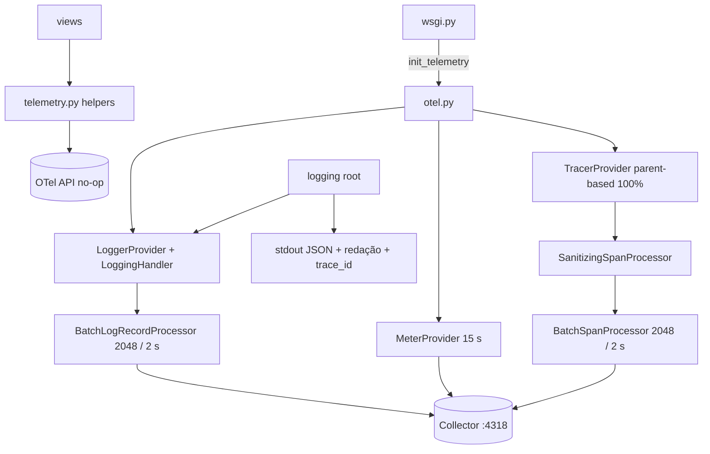

# Telemetria da aplicação Design

**Spec**: `.specs/features/app-telemetry/spec.md`
**Status**: Approved (o usuário mandou implementar o spec; decisões abaixo são as recomendadas)

---

## Architecture Overview

Três camadas, e só a última conhece o SDK.

1. **Código das views** chama helpers de `hairmatch/telemetry.py` (`count_*`, `span`, `set_span_attributes`). Os helpers só usam a API do OpenTelemetry, que é no-op sem provider, e engolem qualquer exceção (TEL-12, TEL-13).
2. **Filtros de log e redação** (`hairmatch/redaction.py`, `hairmatch/logs.py`) valem para o stdout e para o handler OTLP. Não importam o SDK.
3. **Inicialização** (`hairmatch/otel.py`) monta providers, exportadores, instrumentações e o processor de saneamento. Só o `hairmatch/wsgi.py` a chama. Comandos do `manage.py` e o test runner nunca importam o `wsgi.py` (TEL-05).

### Decisões que o spike de 2026-11-07 fechou (versões 1.45.2 do SDK e 0.66b2 da instrumentação)

| Pergunta do Handoff | Resultado medido |
| --- | --- |
| Métrica HTTP estável (TEL-32) | Só com `OTEL_SEMCONV_STABILITY_OPT_IN=http`. Sai `http.server.request.duration` em `s`, com `http.route` e o atributo do template. O `init` define a variável com `os.environ.setdefault` antes de instrumentar. Não vira variável de usuário. |
| Exemplar no histograma (TEL-33) | O ponto do histograma traz `trace_id` e `span_id` do span amostrado, com o filtro padrão `trace_based`. Fica no P1. |
| Preflight `OPTIONS` (TEL-49) | O span se chama `OPTIONS api/postal-codes/<str:cep>` (template, não o path). Não tem `http.route`. O CEP não vaza. |
| Atributos do span SERVER | Traz `client.address` (IP). `url.path` e `url.query` não vêm. O saneador remove a lista de TEL-47 mesmo assim. |
| Queries (TEL-17) | `db.statement` já vem parametrizado (`%s`). Os spans são filhos da requisição. |
| SNS (TEL-48) | A extensão do SNS nomeia o span com o **ARN do endpoint**, grava `messaging.destination*` com o ARN, usa `PRODUCER` e **injeta `MessageAttributes` no `Publish`**. Decisão: remover `"sns"` de `_BOTOCORE_EXTENSIONS` antes de instrumentar. O SNS cai no span genérico `SNS.Publish`, `CLIENT`, sem ARN e sem mudar o pedido. O saneador também remove `messaging.*` e troca `arn:aws:…` por `[arn]` em todo texto. |
| S3 (TEL-23) | O `PutObject` do `upload_fileobj` roda numa thread do s3transfer e perde o pai (novo trace). Decisão: `TransferConfig(use_threads=False)` em `S3MediaStorage._save`. O `DeleteObject` já herda o contexto. |
| `on_commit` (TEL-22) | Roda no thread da requisição, dentro do span SERVER. Nos testes, `captureOnCommitCallbacks(execute=True)`. |
| `requests` (TEL-19) | O span guarda `url.full` com o path (o CEP). O saneador remove `url.full`, `http.url`, `url.path`, `url.query`, `http.target`, e mantém host, método e status. |
| Erro do botocore | O status do span recebe `str(error)`. O saneador redige a descrição (TEL-86) e troca ARNs. |

## Approach (escolhida: processor de saneamento na frente do exportador)

Alternativas consideradas:

- **A. Saneador como `SpanProcessor` que reescreve o `ReadableSpan` antes do `BatchSpanProcessor` (escolhida).** Prod e testes usam a mesma cadeia: nos testes o destino final é um `SimpleSpanProcessor(InMemorySpanExporter)`. Um teste de privacidade prova o que sai em produção.
- B. Filtro dentro de um exportador embrulhado. Os testes trocariam o exportador e deixariam de provar a cadeia real.
- C. Hooks `request_hook`/`response_hook` em cada instrumentação. Não cobre eventos de exceção nem o status gravado depois do hook.

## Code Reuse Analysis

| Component | Location | How to Use |
| --- | --- | --- |
| Expressões de redação do Collector | `docker/observability/otel/config.yaml` | Mesmas regex e ordem em `redaction.py`. Um teste lê o YAML e compara as cinco expressões. |
| `problem_response` / `CATALOG` | `backend/hairmatch/problems.py` | Contador `hairmatch.problems` em `problem_response`; slug `service-unavailable` no `CATALOG`. |
| `notify` / `publish_alert` | `backend/notifications/dispatch.py` | Contador `push.results` por aparelho; sem tocar o contrato. |
| `S3MediaStorage._save` | `backend/hairmatch/storage.py` | `TransferConfig(use_threads=False)`. |
| `to_webp` | `backend/hairmatch/images.py` | Span `image.to_webp` com `bytes_in`/`bytes_out`. |
| `CognitoResetMixin` do runner | `backend/hairmatch/test_runner.py` | O runner instala os providers em memória (TEL-05) e limpa os exporters entre testes. |
| Padrão `push-registration` | `frontend-mobile/utils/push-registration(.web).ts` | `telemetry.ts` / `telemetry.web.ts` com as mesmas exportações. |

## Components

### `hairmatch/redaction.py`
- **Purpose**: redigir texto com as cinco expressões do Collector, mais o JID do WhatsApp (TEL-44).
- **Interfaces**: `redact(text: str) -> str`; `REPLACEMENTS` (tupla ordenada de `(regex, marcador)`); `scrub_urls(text) -> str` (mantém esquema e host, troca o path por `/[path]`, usado só em exceções e status de span).
- **Dependencies**: `re`.

### `hairmatch/logs.py`
- **Purpose**: peças do `LOGGING`.
- **Interfaces**: `TraceContextFilter` (acrescenta `trace_id`/`span_id` só com span válido, TEL-37/38); `RedactionFilter` (devolve **cópia** do registro com mensagem, `exc_text` e `stack_info` redigidos, TEL-44/45/46, usa o retorno de registro do Python 3.12); `ExportErrorRateLimit` (uma linha por logger `opentelemetry.*` a cada 60 s, TEL-15); `StripQueryString` (access log, TEL-43); `JsonFormatter` (python-json-logger com `ts`, `level`, `name`, `message`, `exc_info`).
- **Dependencies**: `python-json-logger`, API do OTel (import protegido).

### `hairmatch/telemetry.py`
- **Purpose**: único ponto que o código de negócio chama.
- **Interfaces**: `count_problem(slug, status)`, `count_reserve_created(channel)`, `count_push(outcome)`, `count_auth_rejection(reason)`, `count_signup(step)`, `count_upload(kind, outcome)`, `count_cep_lookup(source)`, `count_ai_request(feature, outcome)`, `count_ai_tokens(feature, direction, amount)`, `set_span_attributes(**attrs)`, `span(name, **attrs)` (context manager que nunca lança), `gen_ai_span(feature, model)`.
- **Regras**: rótulo fora do conjunto fechado não é registrado (TEL-60). Instrumentos criados sob demanda no medidor global. Toda chamada ao SDK dentro de `try/except Exception`.

### `hairmatch/otel.py`
- **Purpose**: inicialização e desligamento.
- **Interfaces**: `init_telemetry(environ=os.environ) -> bool` (idempotente, TEL-04; endpoint vazio → `False` sem tocar o SDK, TEL-01/02; exceção → um `WARNING` com o tipo, TEL-03); `shutdown_telemetry(timeout=4)` (os três providers em paralelo, TEL-11); `SanitizingSpanProcessor(inner)`; `build_resource(environ)`.
- **Detalhes**: sampler `ParentBased(ALWAYS_ON)` explícito (ignora `OTEL_TRACES_SAMPLER`); exportadores com `timeout=2`; `BatchSpanProcessor`/`BatchLogRecordProcessor` com fila 2048; leitor de métricas a cada 15 s com `export_timeout_millis=2000`; handler `LoggingHandler` com `RedactionFilter` no root; `DjangoInstrumentor(excluded_urls=…health)`, `Psycopg2Instrumentor`, `BotocoreInstrumentor`, `RequestsInstrumentor`; `atexit` e SIGTERM (só na thread principal e só se o handler atual é o padrão).
- **Saneamento (`SanitizingSpanProcessor.on_end`)**: remove `url.query`, `url.full`, `url.path`, `http.url`, `http.target`, `client.address`, `enduser.id`, `http.request.header.*`, `messaging.*`; troca span `aws-api` por nome `<Serviço>.<Operação>` e tipo `CLIENT`; redige (`redact` + `scrub_urls` + ARN) valores string de atributos, `exception.message`, `exception.stacktrace` e a descrição do status (TEL-86).

### `hairmatch/testing_telemetry.py` (só testes)
- **Purpose**: instala, uma vez por processo, providers com exporters/leitores em memória e a mesma cadeia de saneamento; expõe `spans()`, `logs()`, `metric_points(name)`, `clear()`.
- O runner chama `install()` em `setup_test_environment`, antes de `setup_databases`, para o psycopg2 já nascer instrumentado. A suíte inteira roda instrumentada (prova TEL-13).

### `GET /api/health` (`hairmatch/health.py`)
- `APIView` sem autenticação nem throttle, `SELECT 1`, 503 `service-unavailable`. Entra antes do catch-all em `urls.py`, fora da instrumentação por `excluded_urls`.

### App (`frontend-mobile/utils/telemetry.ts`, `telemetry.web.ts`)
- `isTracePropagationEnabled()`, `createTraceparent()`, `traceHeaders()`; o interceptor chama `traceHeaders()` dentro de `try/catch`. Web: `crypto.getRandomValues`. Nativo: `Math.random` em bytes (ID de trace não é segredo, sem pacote novo).

## Data Models

Nenhum modelo novo, nenhuma migração.

## Error Handling Strategy

| Cenário | Tratamento | Impacto |
| --- | --- | --- |
| Endpoint vazio | `init_telemetry` retorna `False`; providers no-op | Nenhum |
| Import/init do SDK falha | `WARNING` com o tipo da exceção; segue sem telemetria | Nenhum |
| Collector fora (3 modos) | Exportação em thread própria, `timeout=2`, fila de 2048 que descarta; erros de exportação limitados a 1 linha/60 s por sinal | Nenhum |
| Helper de métrica/span falha | `except Exception` dentro do helper | Mesma resposta da view |
| Exceção no handler OTLP | `logging` captura (`logging.raiseExceptions` já não propaga em `emit`) | Nenhum |
| Banco fora em `/api/health` | 503 `service-unavailable` | Sonda marca indisponível |

## Risks & Concerns

| Concern | Location | Impact | Mitigation |
| --- | --- | --- | --- |
| `print()` com número do WhatsApp, texto e resposta do Gemini | `chatbot/ai_utils.py:53,92,156,194,197`, `chatbot/views.py:154,196,239,246,361`, `reserve/views.py:422` | PII em stdout | Trocar por `logger` com evento, IDs e tipo da exceção (TEL-41/42). |
| Log do provedor de CEP inclui `str(err)` da exceção do `requests`, que traz a URL com o CEP | `users/cep_lookup.py:59` | CEP em log | Logar só o tipo da exceção. |
| `logger.exception` guarda traceback com valores de exceções | vários (`problems.py:216`, `gemini_client.py`) | e-mail/telefone em traceback | `RedactionFilter` cobre `exc_text`/`stack_info`; teste por fluxo. |
| Instrumentação do botocore injeta `MessageAttributes` e o ARN no SNS | pacote `opentelemetry-instrumentation-botocore` | Pedido diferente e ARN em span | Remover a extensão `sns` do registro; teste com `Stubber` e `expected_params` exato. |
| Registro de extensões é API interna (`_BOTOCORE_EXTENSIONS`) | pacote pinado em `requirements.txt` | Quebra numa troca de versão | Versão exata; teste falha se a chave deixar de existir ou o span voltar a levar ARN. |
| `ReadableSpan` reescrito no saneador usa o construtor público | `otel.py` | Troca de assinatura numa versão futura | Versão exata e teste que compara todos os campos copiados. |
| `upload_fileobj` com `use_threads=False` serializa partes grandes | `hairmatch/storage.py:51` | Upload de arquivo grande mais lento | Os uploads têm no máximo 5 MB e passam antes pelo WebP; sem impacto prático. |
| Suíte inteira passa a rodar instrumentada | `test_runner.py` | Um teste antigo depender do estado do `MIDDLEWARE` | Rodar a suíte completa na T7; falha aqui é achado, não ruído. |
| Cobertura de testes do app é zero | `frontend-mobile/` | Regressão no interceptor | Jest novo com `--watchAll=false` só para os arquivos da feature. |

## Tech Decisions (só as não óbvias)

| Decision | Choice | Rationale |
| --- | --- | --- |
| Gancho de inicialização | `hairmatch/wsgi.py`, antes de `get_wsgi_application()` | O `DjangoInstrumentor` insere o middleware, e isso precisa vir antes do `load_middleware`. `manage.py` e o test runner não importam o `wsgi.py`. No `post_fork` do Gunicorn basta chamar `init_telemetry()` de novo. |
| Providers nos testes | Instalados uma vez por processo pelo runner, leitor de métricas em delta | O `set_*_provider` global só vale uma vez. |
| Modos de Collector fora | Subprocesso por modo (`runserver --noreload`, porta e banco próprios) | Providers globais não voltam atrás. |
| Redação de log | Filtro que devolve cópia do registro | O mesmo registro vai ao stdout e ao OTLP sem um sobrescrever o outro. |
| Marcador de `service.instance.id` | `uuid4` por processo | TEL-31. |

> **Project-level decision** → AD-016 em `.specs/STATE.md`.
