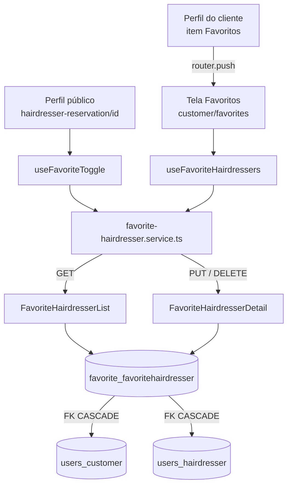

# Cabeleireiros favoritos Design

**Spec**: `.specs/features/favorite-hairdressers/spec.md`
**Context**: `.specs/features/favorite-hairdressers/context.md`
**Status**: Draft

---

## Architecture Overview

Um app Django novo, `favorite`, guarda a relação numa tabela própria e expõe três rotas sob `/api/customers/me/favorite-hairdressers`. No app, dois hooks consomem um serviço novo:
- `useFavoriteToggle` cuida do coração do perfil público;
- `useFavoriteHairdressers` cuida da tela "Favoritos".

Os dois leem a mesma lista do `GET`.



O design segue as decisões ativas do `STATE.md`, sem superar nenhuma:
- **AD-004:** a auth é feita por `authenticated_customer`, e nenhuma view decodifica JWT;
- **AD-006:** os erros saem por `problem_response`, e nenhum slug novo é necessário;
- **AD-007:** as rotas RT-97 a RT-99 entram na Route Table antes do código, e no `test_routes.py`;
- **AD-008:** o cabeleireiro pendente fica fora da lista e não pode ser favoritado.

Nenhuma lição está confirmada (`lessons.py list --status confirmed` vazio). Os candidatos L-016 (atomicidade testada com `TransactionTestCase`), L-018 (ordem padrão provada movendo uma linha) e L-019 (ordem entre validação e busca do pai) entram como cuidado nos testes, mas não como regra.

---

## Code Reuse Analysis

### Existing Components to Leverage

| Component | Location | How to Use |
| --------- | -------- | ---------- |
| `UserPreferenceView` (`PUT` e `DELETE` idempotentes, 204, 404 para o recurso que não existe) | `backend/preferences/views.py:15-42` | Modelo das views de favoritar e desfavoritar |
| App `preferences` (app pequeno, `urls.py` próprio montado em `api/`) | `backend/preferences/` | Modelo do app `favorite` |
| `authenticated_customer` | `backend/users/authentication.py:77` | Auth das três views: 401 `invalid-session`, 503 `auth-unavailable` e 403 `customer-required` |
| `problem_response` | `backend/hairmatch/problems.py` | 404 `not-found` |
| `PublicHairdresserSerializer` | `backend/users/serializers.py:37-42` | Formato de cada item do `GET` (FAV-18) |
| Filtro `user__is_active=True` | `backend/users/views.py:897` (busca) | Mesmo filtro no `GET` e no `PUT` (FAV-05, FAV-22) |
| `CustomerRatingRaceTest` (`TransactionTestCase` + `threading.Barrier`) | `backend/review/tests.py:1120` | Teste de corrida do FAV-03 |
| `assert_problem`, `activate_account` e o cadastro por `POST /api/users` | `backend/hairmatch/problem_testing.py`, `backend/users/testing.py`, `backend/preferences/tests.py:18-50` | Setup e asserções dos testes |
| `gallery.service.ts` (paths relativos ao `axiosInstance`, sem `catch`) | `frontend-mobile/services/gallery.service.ts` | Modelo do serviço novo |
| `useReceivedRatings` (`useFocusEffect` + flag `active` + `isLoaded` + `errorModal`) | `frontend-mobile/hooks/customerHooks/useReceivedRatings.ts` | Modelo dos dois hooks |
| Tela "Avaliações recebidas" | `frontend-mobile/app/(app)/customer/ratings.tsx` | Esqueleto da tela "Favoritos" |
| Card de cabeleireiro da busca | `frontend-mobile/app/(app)/customer/search.tsx:59-79`, `styles/customer/styles/SearchStyle.ts` | Conteúdo e estilo do card |
| `problemMessage`, `ErrorModal` | `frontend-mobile/utils/api-problem.ts:180`, `components/modals/ErrorModal/ErrorModal` | Mensagens de erro (FAV-15, FAV-30 e FAV-33) |
| `HairdresserResponse` | `frontend-mobile/models/Hairdresser.types.ts` | Tipo de cada item da lista. O `PublicHairdresserSerializer` não manda `cnpj`, então o tipo novo é um `Pick` sem ele |

### Integration Points

| System | Integration Method |
| ------ | ------------------ |
| `INSTALLED_APPS` | `'favorite'` entra depois de `'chatbot'` (`backend/hairmatch/settings.py:55-63`) |
| URLconf raiz | `path('api/', include('favorite.urls'))` entra antes do catch-all (`backend/hairmatch/urls.py`) |
| Exclusão de conta | Nenhuma mudança. `_delete_account_rows` termina em `user.delete()` (`backend/users/views.py:256`), e o `CASCADE` de `Customer` e de `Hairdresser` leva os favoritos. O `purge_unconfirmed_users` também usa `user.delete()`. |
| Perfil público | O header de `customer/hairdresser-reservation/[id].tsx` já é `flexDirection: 'row'` com `justifyContent: 'space-between'`. O coração entra como segundo filho. |
| Abas do cliente | `<Tabs.Screen name="favorites" options={{ href: null }} />` em `app/(app)/customer/_layout.tsx` |

---

## Components

### Modelo `FavoriteHairdresser`

- **Purpose**: guardar que um cliente favoritou um cabeleireiro, e quando.
- **Location**: `backend/favorite/models.py` (mais `apps.py`, `__init__.py` e a migração `0001_initial`).
- **Interfaces**: ver Data Models.
- **Dependencies**: `users.Customer` e `users.Hairdresser`.
- **Reuses**: a estrutura do app `preferences`.

### `FavoriteHairdresserList` (`GET`, RT-97)

- **Purpose**: listar os favoritos do cliente da sessão.
- **Location**: `backend/favorite/views.py`
- **Interfaces**: `get(request) -> 200 {"data": [PublicHairdresser]}`
- **Behavior**:
  1. `session, customer, error = authenticated_customer(request)`, e retorna `error` se houver.
  2. `FavoriteHairdresser.objects.filter(customer=customer, hairdresser__user__is_active=True).select_related('hairdresser__user')` usa a ordem padrão do modelo.
  3. Retorna `JsonResponse({'data': PublicHairdresserSerializer([f.hairdresser for f in favorites], many=True).data})`.
- **Reuses**: `PublicHairdresserSerializer` e o filtro da busca.

### `FavoriteHairdresserDetail` (`PUT` RT-98, `DELETE` RT-99)

- **Purpose**: favoritar e desfavoritar, os dois idempotentes.
- **Location**: `backend/favorite/views.py`
- **Interfaces**:
  - `put(request, hairdresser_id) -> 204 | 401 | 403 | 404`
  - `delete(request, hairdresser_id) -> 204 | 401 | 403 | 404`
- **Behavior**:
  - `put`:
    1. faz a auth;
    2. busca `Hairdresser.objects.filter(id=hairdresser_id, user__is_active=True).first()`, e devolve 404 `not-found` (`'Hairdresser not found.'`) se não achar;
    3. chama `FavoriteHairdresser.objects.get_or_create(customer=customer, hairdresser=hairdresser)`;
    4. responde `HttpResponse(status=204)`.

    O `get_or_create` do Django pega o `IntegrityError` da `UniqueConstraint` quando dois `PUT` se cruzam e relê a linha. Por isso o segundo também responde 204, e só uma linha fica (FAV-03). O `created_at` da linha que já existe não muda (FAV-02).
  - `delete`:
    1. faz a auth;
    2. busca `Hairdresser.objects.filter(id=hairdresser_id).first()`, sem filtro de `is_active`, e devolve 404 se não achar;
    3. chama `FavoriteHairdresser.objects.filter(customer=customer, hairdresser=hairdresser).delete()`;
    4. responde 204.
- **Reuses**: `UserPreferenceView`.

### `favorite/urls.py`

```python
urlpatterns = [
    path('customers/me/favorite-hairdressers', FavoriteHairdresserList.as_view(), name='favorite_hairdressers'),
    path('customers/me/favorite-hairdressers/<int:hairdresser_id>', FavoriteHairdresserDetail.as_view(), name='favorite_hairdresser'),
]
```

O path já é plural, então `SINGULAR_SEGMENTS` não muda. Com `<int:...>`, um `{id}` não inteiro cai no catch-all, que responde 404 `not-found` (FAV-39). Um método sem handler responde 405 `method-not-allowed` com o `Allow` do DRF (FAV-42).

### `favorite-hairdresser.service.ts`

- **Purpose**: as três chamadas da API.
- **Location**: `frontend-mobile/services/favorite-hairdresser.service.ts`
- **Interfaces**:
  - `listFavoriteHairdressers(): Promise<FavoriteHairdresser[]>`, que devolve `response.data.data`;
  - `addFavoriteHairdresser(hairdresserId: number): Promise<void>`, que faz o `PUT`;
  - `removeFavoriteHairdresser(hairdresserId: number): Promise<void>`, que faz o `DELETE`.
- **Reuses**: `gallery.service.ts`. Os paths são relativos ao `axiosInstance`, e nenhuma chamada usa `catch`, porque os chamadores leem a falha com `problemMessage`.
- O tipo `FavoriteHairdresser` fica em `frontend-mobile/models/FavoriteHairdresser.types.ts`, como `Pick<HairdresserResponse, 'id' | 'user' | 'resume'>`.

### `useFavoriteToggle(hairdresserId)`

- **Purpose**: estado e ação do coração do perfil público.
- **Location**: `frontend-mobile/hooks/customerHooks/useFavoriteToggle.ts`
- **Interfaces**: `{ isFavorite: boolean, disabled: boolean, toggle(): void, errorModal, closeError }`
- **Behavior**:
  - No foco (`useFocusEffect`), o hook chama `listFavoriteHairdressers()`. Se a chamada der certo, `isFavorite` é a pertença do `hairdresserId`, e o coração fica habilitado. Se falhar, `isFavorite` é `false`, e o coração fica desabilitado (FAV-17).
  - `toggle`:
    - guarda o estado anterior, inverte `isFavorite` e marca `pending`;
    - chama o `PUT` ou o `DELETE`;
    - na falha, volta o estado e abre o `errorModal` com `problemMessage(error, 'Não foi possível atualizar seus favoritos.')`;
    - no fim, limpa `pending`.
  - `disabled` vale `pending || !loaded` (FAV-16).
- **Reuses**: o padrão de `useReceivedRatings`.

### Coração no perfil público

- **Location**: `frontend-mobile/app/(app)/customer/hairdresser-reservation/[id].tsx` (modificado).
- **Behavior**:
  - Um `TouchableOpacity` com `Ionicons name={isFavorite ? 'heart' : 'heart-outline'}`, `size={24}` e `disabled={disabled}` entra à direita do voltar, no header.
  - O `ErrorModal` entra no fim da tela.
  - O `id` vem do `useLocalSearchParams`, como no `useHairdresserProfile`, e não do `hairdresser.id` carregado. A aba mantém a tela montada, então, ao abrir outro perfil a partir de "Favoritos", o `hairdresser` antigo continua vivo até o novo carregar.
  - `accessibilityLabel` diz "Remover dos favoritos" ou "Adicionar aos favoritos".

### `useFavoriteHairdressers`

- **Purpose**: estado e ações da tela "Favoritos".
- **Location**: `frontend-mobile/hooks/customerHooks/useFavoriteHairdressers.ts`
- **Interfaces**: `{ favorites, isLoaded, removing: boolean, handleRemove(id), handleOpen(id), handleGoBack, errorModal, closeError }`
- **Behavior**:
  - **Foco:** chama `listFavoriteHairdressers()`; no sucesso, preenche `favorites` e marca `isLoaded=true` (FAV-26); na falha, abre o `errorModal` com o fallback "Não foi possível carregar seus favoritos." (FAV-30).
  - **`handleRemove(id)`:**
    1. guarda o índice e o item, tira o item da lista e marca `removing` (FAV-32, FAV-35);
    2. chama `removeFavoriteHairdresser(id)`;
    3. na falha, devolve o item ao mesmo índice e abre o `errorModal` (FAV-33);
    4. no fim, limpa `removing`.
  - **`handleOpen(id)`:** faz `router.push(\`/(app)/customer/hairdresser-reservation/${id}\`)` (FAV-28).
  - **`handleGoBack`:** faz `router.push('/(app)/customer/profile')` (FAV-25).
- **Reuses**: `useReceivedRatings`.

### Tela "Favoritos"

- **Location**: `frontend-mobile/app/(app)/customer/favorites.tsx`
- **Behavior**:
  - O esqueleto é o de `ratings.tsx`, com o título "Favoritos".
  - O `ListEmptyComponent` só aparece com `isLoaded` e mostra "Você ainda não tem cabeleireiros favoritos." (FAV-29, FAV-34).
  - O card é um `TouchableOpacity` com `onPress={() => handleOpen(item.id)}` e mostra:
    - `Image`: a foto, ou o placeholder `assets/images/profile_picture_placeholder.png`;
    - o nome e o sobrenome;
    - a estrela com `user.rating?.toFixed(1) ?? '5.0'`;
    - "bairro, cidade".

    No lugar da seta da busca, o card tem um `TouchableOpacity` com `Ionicons name="heart"`, `disabled={removing}` e `onPress={() => handleRemove(item.id)}` (FAV-27, FAV-31).
  - O estilo do card é copiado de `SearchStyle.ts` para um `StyleSheet` local, como `ratings.tsx` faz.
- **Rota**: `<Tabs.Screen name="favorites" options={{ href: null }} />` em `customer/_layout.tsx`.

### Menu "Favoritos" do perfil do cliente

- **Location**: `frontend-mobile/hooks/customerHooks/useCustomerProfile.ts` (acrescenta `handleFavorites`, que faz `router.push('/(app)/customer/favorites')`) e `frontend-mobile/app/(app)/customer/profile.tsx` (o `MenuItem` "Favoritos" passa a chamar `handleFavorites`).

---

## Data Models

### `FavoriteHairdresser` (app `favorite`)

```python
class FavoriteHairdresser(models.Model):
    customer = models.ForeignKey(Customer, on_delete=models.CASCADE, related_name='favorite_hairdressers')
    hairdresser = models.ForeignKey(Hairdresser, on_delete=models.CASCADE, related_name='favorited_by')
    created_at = models.DateTimeField(auto_now_add=True)

    class Meta:
        ordering = ['-created_at', '-id']
        constraints = [
            models.UniqueConstraint(fields=['customer', 'hairdresser'], name='unique_favorite_hairdresser'),
        ]
```

**Relationships**:
- N:1 com `Customer` e N:1 com `Hairdresser`, os dois com `CASCADE` (FAV-36 a FAV-38 e FAV-43).
- A `UniqueConstraint` cria o índice composto `(customer_id, hairdresser_id)`, que atende o filtro por cliente do `GET`.
- O `CASCADE` a partir do cabeleireiro usa o índice próprio da FK `hairdresser_id`, que o Django cria.
- O expurgo e a substituição de conta pendente (AD-008) também terminam em `user.delete()`, então levam os favoritos (FAV-38, FAV-43).

### Resposta do `GET` (RT-97)

```json
{"data": [{"id": 3, "resume": "...", "user": {"id": 10, "first_name": "Ana", "last_name": "Lima", "profile_picture": "https://...", "rating": 5.0, "role": "hairdresser", "address": "...", "number": "...", "complement": "...", "neighborhood": "Centro", "city": "Manaus", "state": "AM"}}]}
```

---

## Error Handling Strategy

| Error Scenario | Handling | User Impact |
| -------------- | -------- | ----------- |
| Sem sessão ou com a sessão expirada | `authenticated_customer` responde 401 `invalid-session`. O `axiosInstance` tenta o refresh. | O app renova a sessão ou leva ao login, como em toda rota protegida. |
| Sessão de cabeleireiro | 403 `customer-required` | Não acontece pelo app, porque a tela é do grupo `customer`. |
| `{id}` inexistente ou pendente no `PUT` | 404 `not-found` | O coração volta ao estado anterior, e o modal mostra o texto de `not-found`. |
| `{id}` inexistente no `DELETE` | 404 `not-found` | Na lista, o card volta e o modal aparece. O `DELETE` só responde 404 se o cabeleireiro não existe mais, e então a conta saiu e o `CASCADE` já apagou o favorito. |
| Dois `PUT` simultâneos | `get_or_create` relê a linha depois do `IntegrityError`. | Os dois recebem 204. |
| Falha de rede | `ApiConnectionError` do `axiosInstance` e `problemMessage` com `CONNECTION_ERROR_MESSAGE` | O estado volta, e o modal diz "Não foi possível conectar ao servidor.". |
| Erro inesperado | 500 `internal-error`, logado (AD-006) | O estado volta, e o modal mostra o texto genérico. |

---

## Risks & Concerns

| Concern | Location (file:line) | Impact | Mitigation |
| ------- | -------------------- | ------ | ---------- |
| Corrida de dois `PUT` | `backend/favorite/views.py` | O projeto não usa `ATOMIC_REQUESTS` (`backend/hairmatch/settings.py`), e o `get_or_create` abre um `transaction.atomic` próprio no insert e relê a linha depois do `IntegrityError`. Mas o `TestCase` embrulha cada teste numa transação e esconderia uma regressão. | O T2 tem o teste de corrida com `TransactionTestCase` e `threading.Barrier`, como o `CustomerRatingRaceTest` (lição candidata L-016). |
| A ordem padrão pode estar certa só por acaso | `backend/favorite/models.py` | Com inserts em sequência, a ordem do `id` esconde um `Meta.ordering` ausente. | O teste do T1 grava `created_at` fora da ordem de inserção com `update()` antes de ler (lição candidata L-018). |
| Merge com outras features que tocam `INSTALLED_APPS`, `hairmatch/urls.py` e `test_routes.py` | `backend/hairmatch/` | Conflito textual numa linha. | As mudanças são aditivas, de uma linha cada, e o `test_routes.py` acusa qualquer rota esquecida. |
| O perfil público carrega a lista inteira de favoritos só para pintar um ícone | `useFavoriteToggle` | Uma requisição a mais por abertura de perfil, com payload proporcional ao número de favoritos. | A lista não pagina e é pequena para um cliente. Se crescer, uma rota de consulta por item (`GET .../{id}`) entra sem mudar as outras. |
| `useHairdresserProfile` engole erros e só registra no console | `frontend-mobile/hooks/customerHooks/useHairdresserReservation.ts:50-52` | Nenhum impacto nesta feature. O coração tem um hook próprio com tratamento de erro. | Nada a fazer aqui. |

---

## Tech Decisions (only non-obvious ones)

| Decision | Choice | Rationale |
| -------- | ------ | --------- |
| Onde fica o modelo | App novo `favorite`, e não em `users` | Segue o `preferences`. Não disputa a sequência de migrações de `users` com outras features em paralelo, e não cresce o `users/views.py` (1000+ linhas). |
| Tabela explícita × `ManyToManyField` simples | Tabela explícita com `created_at` | A ordem da lista (FAV-19) precisa do momento do favorito. |
| Estado inicial do coração | Pertença na lista do `GET` | Uma rota a menos, e nenhum `is_favorite` nos serializers que a busca e a home compartilham. |
| `DELETE` não filtra `is_active` | Só a existência do cabeleireiro conta. | Desfavoritar nunca precisa ser bloqueado, e o `DELETE` segue idempotente para qualquer cabeleireiro que existe. |

Nenhuma decisão aqui vira regra de projeto, então não entra AD novo no `STATE.md`.
