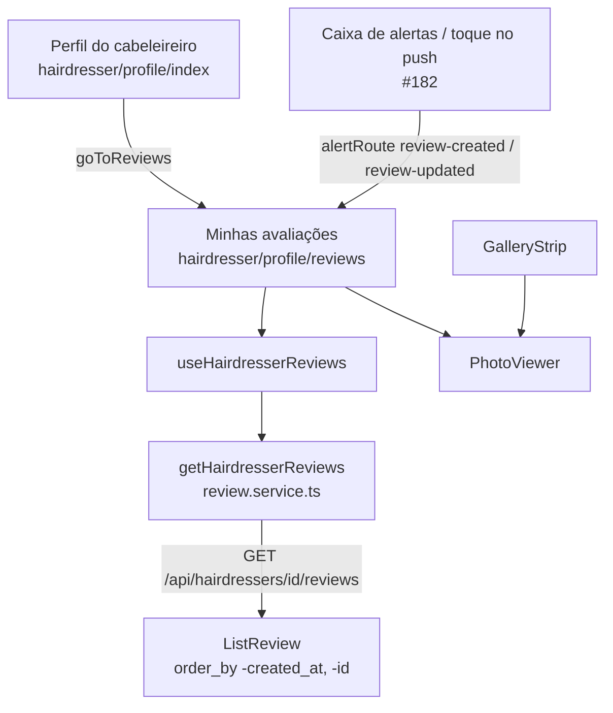

# Minhas avaliações (cabeleireiro) Design

**Spec**: `.specs/features/hairdresser-reviews/spec.md`
**Context**: `.specs/features/hairdresser-reviews/context.md`
**Status**: Draft

---

## Architecture Overview

O backend muda uma linha: o `ListReview` passa a ordenar por `-created_at, -id`. No app, entram:
- uma tela nova na pilha do perfil do cabeleireiro (`hairdresser/profile/reviews`), com hook próprio;
- uma função de serviço que chama a RT-24 que já existe;
- um visualizador de fotos extraído do `GalleryStrip`, que a galeria e a tela nova passam a usar.

Depois da #182, o `alertRoute` passa a levar `review-created` e `review-updated` para essa tela.



O design segue as decisões ativas do `STATE.md` e não supera nenhuma:
- **AD-006:** a tela lê os erros por `problemMessage`, e nenhum slug novo é necessário;
- **AD-007:** nenhuma rota entra nem sai, e só a coluna de notas do RT-24 na Route Table ganha a ordem;
- **AD-011:** as fotos vêm de `ReviewPicture`, de 0 a 5 por review, por `id` crescente;
- **AD-014:** o toque segue o fluxo da #182 (`PATCH` do alerta e depois `alertRoute`), e só o destino de dois `kind` muda.

Nenhuma lição está confirmada (`lessons.py list --status confirmed` vazio). A candidata L-018 (provar a ordem padrão movendo uma linha) vale para o teste de ordem do T1.

---

## Code Reuse Analysis

### Existing Components to Leverage

| Component | Location | How to Use |
| --------- | -------- | ---------- |
| `ListReview` e `ReviewSerializer` | `backend/review/views.py:140-149`, `backend/review/serializers.py:18-23` | Só a ordem muda. O formato do item fica igual (HRV-03). |
| Ordem `-created_at, -id` | `backend/review/views.py:396` (`CustomerRatingsByCustomer`) | Mesma ordem e mesmo desempate. |
| `ReviewsTestCase` e `ListReviewPicturesTest` | `backend/review/tests.py:570`, `:1704` | Setup dos testes novos. As fotos já são cobertas pelo `ListReviewPicturesTest`. |
| `useReceivedRatings` | `frontend-mobile/hooks/customerHooks/useReceivedRatings.ts` | Modelo do `useHairdresserReviews` |
| Tela "Avaliações recebidas" | `frontend-mobile/app/(app)/customer/ratings.tsx` | Esqueleto e estilo da tela |
| `StarRating` | `frontend-mobile/components/StarRating/StarRating.tsx` | Estrelas só de leitura (HRV-09) |
| `GalleryStrip` (modal de foto em tela cheia) | `frontend-mobile/components/gallery/GalleryStrip.tsx:31-46` | Fonte do `PhotoViewer` |
| `problemMessage`, `ErrorModal` | `frontend-mobile/utils/api-problem.ts:180`, `components/modals/ErrorModal/ErrorModal` | HRV-16 |
| `useHairdresserProfile` (`goToGallery`) | `frontend-mobile/hooks/hairdresserHooks/useHairdresserProfile.ts:36` | Modelo do `goToReviews` |
| `alertRoute` (#182) | `frontend-mobile/utils/alert-routes.ts`, criado pelo T16 da #182 | Ganha o destino dos dois `kind` |

### Integration Points

| System | Integration Method |
| ------ | ------------------ |
| RT-24 | O app chama `GET /api/hairdressers/{userInfo.hairdresser.id}/reviews` pelo `axiosInstance`. A rota é pública, e o cookie de sessão vai junto sem efeito. |
| Pilha do perfil | `<Stack.Screen name="reviews" />` em `app/(app)/hairdresser/profile/_layout.tsx`. A #182 acrescenta `notifications` no mesmo arquivo, e o conflito de merge é de uma linha. |
| Typed routes | A rota `/(app)/hairdresser/profile/reviews` só existe para o `tsc` depois que o Metro regenera os typed routes (memória `api-e2e-and-tsc-gotchas`). |
| Push e caixa (#182) | `alertRoute(kind, role)` passa a devolver `'/(app)/hairdresser/profile/reviews'` para `review-created` e `review-updated`. `usePushNotifications` e `useAlerts` já navegam pelo retorno, então não mudam. |

---

## Components

### `ListReview` (RT-24)

- **Purpose**: listar as reviews de um cabeleireiro, da mais recente para a mais antiga.
- **Location**: `backend/review/views.py:140`
- **Interfaces**: `get(request, hairdresser_id) -> 200 {"data": [Review]}`, sem mudança de contrato.
- **Change**: `.order_by('id')` vira `.order_by('-created_at', '-id')`. O comentário da linha passa a explicar o desempate. O `prefetch_related('pictures')` mantém as fotos por `ReviewPicture.Meta.ordering = ['id']`.
- **Tests**:
  - o `test_list_reviews` passa a esperar a review mais recente primeiro;
  - testes novos de ordem com `created_at` reescrito fora da ordem de inserção, de desempate por `id`, de isolamento entre cabeleireiros e de estabilidade depois de um `PUT`;
  - um teste do formato do item, com as chaves de topo e o `customer` aninhado. Nenhum teste atual o prova, e o `ReviewSerializer` usa `fields = '__all__'`, então um campo novo no modelo mudaria a resposta sem aviso.

### `getHairdresserReviews` e o tipo `ReceivedReview`

- **Purpose**: chamar a RT-24 e tipar a resposta real.
- **Location**: `frontend-mobile/services/review.service.ts`, com o tipo em `frontend-mobile/models/Review.types.ts`.
- **Interfaces**:
  - `getHairdresserReviews(hairdresserId: number): Promise<ReceivedReview[]>`, que devolve `response.data.data`, sem `catch`.
  - O tipo é `interface ReceivedReview extends Omit<Review, 'customer'> { customer: { id: number; user: { id: number; first_name: string; last_name: string } } }`.
- **Reuses**: as outras funções do `review.service.ts` (`axiosInstance` e `withCredentials`).

### `useHairdresserReviews`

- **Purpose**: estado da tela e navegação de volta.
- **Location**: `frontend-mobile/hooks/hairdresserHooks/useHairdresserReviews.ts`
- **Interfaces**: `{ reviews, isLoaded, errorModal, closeError, handleGoBack }`
- **Behavior**:
  - O `hairdresserId` vem de `userInfo?.hairdresser?.id`. Sem ele, o hook não chama nada (HRV-30).
  - No `useFocusEffect`, o hook chama `getHairdresserReviews`, com a flag `active`:
    - no sucesso, faz `setReviews(...)` e `setIsLoaded(true)` (HRV-06, HRV-15);
    - na falha, mostra o `errorModal` com `problemMessage(error, 'Não foi possível carregar suas avaliações.')` (HRV-16).
  - `handleGoBack` chama `router.back()` (HRV-17, HRV-21). O HRV-18 vem da rota inicial da pilha do perfil (ver a tela).
- **Reuses**: `useReceivedRatings`.

### `PhotoViewer`

- **Purpose**: mostrar uma foto em tela cheia, com o botão de fechar.
- **Location**: `frontend-mobile/components/PhotoViewer.tsx`
- **Interfaces**: `PhotoViewer({ uri: string | null, onClose: () => void })`. Fica visível enquanto `uri !== null`.
- **Behavior**: é o `Modal` do `GalleryStrip` movido sem mudança visual, com `transparent`, `fade`, fundo `rgba(0,0,0,0.92)`, `resizeMode="contain"` e o botão `close` com `accessibilityLabel="Fechar foto"`. O `GalleryStrip` passa a usar o componente com `uri={opened?.image ?? null}`.
- **Reuses**: o modal e os estilos `viewer`, `fullImage` e `closeButton` do `GalleryStrip`.

### Tela "Minhas avaliações"

- **Location**: `frontend-mobile/app/(app)/hairdresser/profile/reviews.tsx`. Em `profile/_layout.tsx`, a tela ganha o `Stack.Screen`, e o arquivo exporta `unstable_settings = { initialRouteName: 'index' }`. Assim, uma entrada direta em `profile/reviews` (push com o app fechado) monta o perfil por baixo, e `router.back()` cai nele (HRV-18).
- **Behavior**:
  - O esqueleto é o de `customer/ratings.tsx`, com o título "Minhas avaliações" e o "‹ Voltar" ligado a `handleGoBack` (HRV-07).
  - O `useFocusEffect` recarrega a lista, mas uma tela que já está montada mantém a rolagem. O topo do HRV-25 vem do `router.push` do toque, que cria uma instância nova da tela.
  - O `ListEmptyComponent` só aparece com `isLoaded` e mostra "Você ainda não recebeu avaliações." (HRV-15).
  - O card tem:
    - um cabeçalho com `StarRating rating={item.rating} size={18}`, o valor da nota por `formatRating` e a data `dayjs(item.created_at).format('DD/MM/YYYY')` (HRV-09, HRV-10);
    - o nome `customer.user.first_name last_name` (HRV-08);
    - o comentário só quando `item.comment?.trim()` (HRV-11, HRV-12);
    - as fotos, quando `item.pictures.length > 0`, numa faixa horizontal (`ScrollView horizontal`) com uma miniatura `TouchableOpacity` por foto, cujo `accessibilityLabel` é "Abrir foto" e cujo `onPress` faz `setOpened(picture.url)` (HRV-13, HRV-29).
  - Um único `PhotoViewer` por tela recebe `uri={opened}` (HRV-14).
- **`formatRating(rating: number): string`**: uma função local da tela. Devolve `String(rating)` quando `Number.isInteger(rating)` e `rating.toFixed(1).replace('.', ',')` nos outros casos.

### Card "Minhas avaliações" no perfil

- **Location**: `frontend-mobile/app/(app)/hairdresser/profile/index.tsx` e `hooks/hairdresserHooks/useHairdresserProfile.ts`.
- **Behavior**: o hook ganha `goToReviews = () => router.push('/(app)/hairdresser/profile/reviews')`. A tela ganha um `TouchableOpacity` com `styles.card`, o texto "Minhas avaliações" e a seta, logo abaixo de "Minha galeria" (HRV-19, HRV-20).

### `alertRoute` (depois da #182)

- **Location**: `frontend-mobile/utils/alert-routes.ts`
- **Change**:
  - `review-created` e `review-updated` passam a devolver `'/(app)/hairdresser/profile/reviews'` (HRV-22 a HRV-24);
  - `review-deleted` continua `null` (HRV-26);
  - os outros `kind` não mudam (HRV-27).
- **Spec amendment**, no mesmo commit:
  - `push-notifications/spec.md`:
    - as células "Toque" de `review-created` e `review-updated` no catálogo passam a ser "Minhas avaliações (`/(app)/hairdresser/profile/reviews`)";
    - o NOTIF-34 e o NOTIF-63 passam a dizer que o toque marca como lido e segue o catálogo, e o `review-deleted` fica na caixa;
    - a linha "Tela de reviews recebidas" sai do Out of Scope, e a assumption "Toque no alerta de review" passa a apontar para esta feature.
  - `push-notifications/tasks.md`: o item do T16 que espera `null` para `review-*` passa a esperar `null` só para `review-deleted`.
  - Essa emenda muda o resultado esperado pela spec. Não enfraquece um teste.

---

## Data Models

Nenhum modelo muda. O item da RT-24 que o app passa a ler:

```json
{"id": 7, "rating": 4.5, "comment": "Adorei o corte", "created_at": "2026-10-11T14:03:22.512Z",
 "customer": {"id": 3, "user": {"id": 12, "first_name": "Ana", "last_name": "Lima"}},
 "hairdresser": 2, "pictures": [{"id": 31, "url": "http://localhost:4566/..."}]}
```

---

## Error Handling Strategy

| Error Scenario | Handling | User Impact |
| -------------- | -------- | ----------- |
| Falha de rede no `GET` | `ApiConnectionError` do `axiosInstance` e `problemMessage` | O `ErrorModal` mostra "Não foi possível conectar ao servidor.", sem a mensagem de lista vazia. |
| Erro inesperado (500 `internal-error`) | `problemMessage` com o fallback | O `ErrorModal` mostra o texto genérico do slug. |
| Foto que não carrega (URL expirada ou objeto apagado) | O `Image` falha em silêncio. | A miniatura fica vazia, e o resto do card aparece. |
| Toque com o app fechado, sem histórico | A rota inicial `index` da pilha do perfil fica por baixo da tela. | "‹ Voltar" abre o perfil. |
| Alerta de outra conta (404 no `PATCH`, #182) | Fluxo da #182: abre a caixa. | A tela não abre. |

---

## Risks & Concerns

| Concern | Location (file:line) | Impact | Mitigation |
| ------- | -------------------- | ------ | ---------- |
| O `test_list_reviews` afirma a ordem crescente | `backend/review/tests.py:602-618` | O teste quebra com a ordem nova. | O T1 atualiza as asserções para a ordem do spec (HRV-01) no mesmo commit. É mudança de spec, não teste enfraquecido. |
| A ordem pode estar certa só por acaso | `backend/review/views.py:146` | Com inserts em sequência, `-id` e `-created_at` coincidem e esconderiam um `order_by` errado. | O teste do HRV-01 reescreve o `created_at` por `update()` fora da ordem de inserção (lição candidata L-018). O do HRV-02 iguala o `created_at` de duas reviews. |
| A tela e o `GalleryStrip` passam a depender do `PhotoViewer` | `frontend-mobile/components/gallery/GalleryStrip.tsx` | Uma regressão na extração quebraria a galeria da #118. | A extração é um task próprio (T4), sem mudança visual, e o UAT (T8) refaz a abertura de foto na galeria. |
| A P2 depende de código que ainda não existe | `frontend-mobile/utils/alert-routes.ts` (#182, T16) | O T7 não compila sem a #182. | O T7 fica numa fase própria, com a #182 mesclada como pré-requisito. As fases 1 e 2 saem sem ela. |
| Comportamento de `initialRouteName` numa pilha dentro de abas (expo-router 57) | `frontend-mobile/app/(app)/hairdresser/profile/_layout.tsx` | Se o expo-router não montar o `index` por baixo numa entrada direta, "‹ Voltar" num cold start pelo push sairia da tela errada. | Não foi conferido na documentação. O UAT (T8, passo 6) prova o caminho. Se falhar, o `handleGoBack` passa a `router.replace('/(app)/hairdresser/profile')` quando `router.canGoBack()` é falso, como tarefa de correção. |
| `StarRating` sem meia estrela | `frontend-mobile/components/StarRating/StarRating.tsx:19` | Uma nota 4,5 mostra 4 estrelas. | O valor numérico ao lado (HRV-09) mostra a fração. |
| A RT-24 não pagina | `backend/review/views.py:142` | A lista cresce com o número de atendimentos. | Fora do escopo. A `FlatList` virtualiza o render, e a paginação entra quando a lista crescer. |

---

## Tech Decisions (only non-obvious ones)

| Decision | Choice | Rationale |
| -------- | ------ | --------- |
| Onde ordenar | No backend | Uma ordem só para todo consumidor da RT-24, igual à de `CustomerRatingsByCustomer`. |
| Rota da tela | RT-24 com o `id` da sessão | Dados já públicos. Uma rota `me` exigiria a Route Table e o `test_routes.py` sem ganho. |
| Visualizador de foto | Extrair `PhotoViewer` do `GalleryStrip` | Duas telas com o mesmo modal. O `GalleryStrip` usa `GalleryPhoto.image`, e a review usa `ReviewPicture.url`, então o componente recebe só a URI. |
| Volta sem histórico | `unstable_settings.initialRouteName = 'index'` na pilha do perfil e `router.back()` | Um toque com o app fechado abre a tela sem pilha. A rota inicial põe o perfil por baixo e dispensa um ramo `canGoBack` que, no cold start, a navegação da #182 pode tornar verdadeiro apontando para outra aba. |
| Destaque da review do alerta | Nenhum | Decisão do usuário. Evita mudar o payload do push da #182. |

Nenhuma decisão aqui vira regra de projeto, então não entra AD novo no `STATE.md`.
