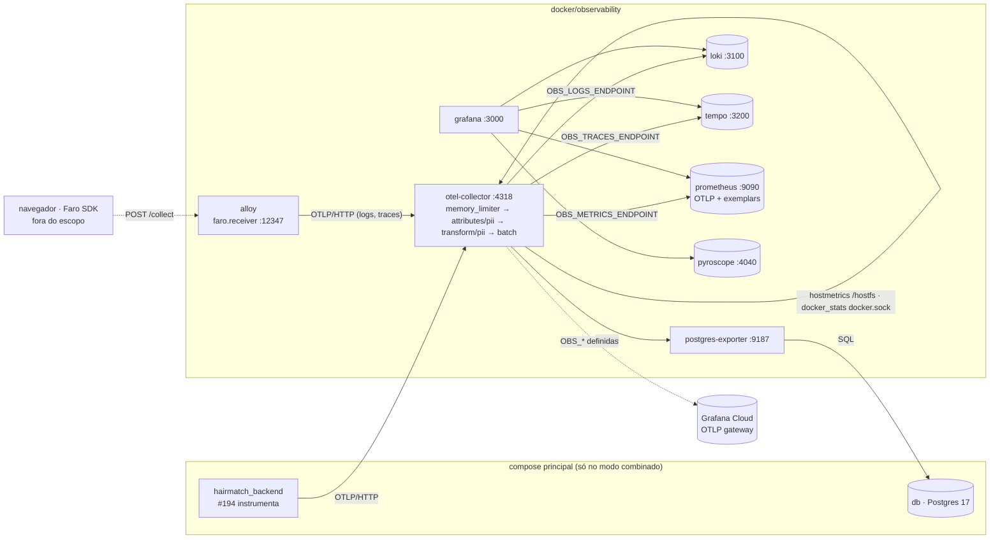

# Stack de observabilidade local Design

**Spec**: `.specs/features/observability-stack/spec.md`
**Context**: `.specs/features/observability-stack/context.md`
**Status**: Draft

---

## Architecture Overview

A stack inteira mora em `docker/observability/`. A aplicação manda telemetria só ao Collector, por OTLP/HTTP. O Collector redige os dados e exporta cada sinal para um endpoint. Por padrão, esses endpoints são o Tempo, o Prometheus e o Loki locais; as variáveis `OBS_*` trocam o destino para o Grafana Cloud.

O Grafana lê os três backends e o Pyroscope. O Alloy recebe o Faro do navegador e reenvia ao Collector, para que os dados passem pela mesma redação.

### Dois modos de subir

| Modo | Comando | Projeto | Rede da stack | `.env` lido |
| --- | --- | --- | --- | --- |
| Sozinha | `docker compose -f docker/observability/docker-compose.observability.yml up -d` | `observability` (nome do diretório) | `observability_app_network` | `docker/observability/.env`, que não existe, então valem os padrões. Para o Grafana Cloud, as `OBS_*` vão no shell do comando, nunca por `--env-file docker/.env`, cujo `OBS_DIR` quebraria os mounts. |
| Combinado | `docker compose -f docker/docker-compose.yml -f docker/observability/docker-compose.observability.yml up -d` | `hairmatch` | `hairmatch_app_network`, a mesma do backend | `docker/.env` |

Fatos conferidos em 2026-11-07, com o Docker 29.1.3 e o Compose 2.40.3, em projetos descartáveis:
- **Dois projetos com a mesma rede de nome fixo não funcionam.** O segundo `up` avisa "a network with name … exists but was not created for project", tenta recriar a rede e falha com "has active endpoints". Isso acontece nas duas ordens.
- **No modo combinado, os caminhos relativos do segundo arquivo partem do diretório do primeiro.** Um bind mount `./conf.txt` virou um diretório vazio. Por isso todo mount usa `${OBS_DIR:-.}`, e o `docker/.env` define `OBS_DIR=./observability`.
- **Volumes com `name:` fixo são os mesmos nos dois modos.** O modo combinado reaproveitou o volume criado pela stack sozinha.
- **O `name:` do último arquivo vence no modo combinado.** Por isso o arquivo de observabilidade não declara `name:` (OBS-06).

---

## Code Reuse Analysis

### Existing Components to Leverage

| Component | Location | How to Use |
| --- | --- | --- |
| Convenção do compose principal | `docker/docker-compose.yml` | `container_name: hairmatch_*`, rede `app_network` e comentários curtos em inglês sobre o porquê de cada config. |
| Credenciais do banco de dev | `docker/.env.example` (`POSTGRES_*`) | O postgres-exporter usa as mesmas variáveis no modo combinado. |
| Config do Collector do estudo | Estudo, aba "Collector" | Base dos receivers, do `memory_limiter`, de `attributes/pii`, de `transform/pii`, do `batch`, do `file_storage` e do `sending_queue`. |
| Compose de produção do estudo | Estudo, aba "Compose" | `x-logging` (`max-size: 10m`, `max-file: 3`), `user: "0:0"`, `/:/hostfs:ro`, `docker.sock:ro` e `mem_limit: 300m`. |
| Consultas PromQL do estudo | Estudo, seção 8 | Base dos painéis RED (`http_server_request_duration_seconds_*`, `http_route`, status 5xx). |
| Origem do Metro | Memória do projeto: CORS fixa o Metro em `:8081` | `cors_allowed_origins` do `faro.receiver`. |

### Integration Points

| System | Integration Method |
| --- | --- |
| Backend Django (#194) | `OTEL_EXPORTER_OTLP_ENDPOINT=http://otel-collector:4318`, só no modo combinado. Esta feature não muda o backend. |
| Postgres do compose principal | O postgres-exporter conecta em `db:5432` pela `app_network`. Sozinha, a stack não alcança o banco, e o exporter reporta `pg_up 0`. |
| Docker do host | O `docker_stats` lê `/var/run/docker.sock` (read-only), com `api_version: "1.44"`. |
| Grafana Cloud (futuro) | O mesmo `otlp_http`, com `OBS_*_ENDPOINT` apontando para o OTLP gateway e `OBS_OTLP_AUTH_HEADER=Basic <base64(instanceID:token)>`. |

---

## Components

### Compose de observabilidade
- **Purpose**: declara os serviços, a rede, os volumes nomeados e a rotação de log.
- **Location**: `docker/observability/docker-compose.observability.yml`
- **Interfaces**: os serviços `otel-collector`, `loki`, `tempo`, `prometheus`, `pyroscope`, `alloy`, `grafana` e `postgres-exporter`, mais `otlp-capture` com `profiles: [verify]`, que só sobe nos testes.
- **Dependencies**: nenhuma do compose principal. Os `depends_on` são internos: o Grafana depende dos backends, e o Collector, do Loki, do Tempo e do Prometheus.
- **Reuses**: o estilo do `docker/docker-compose.yml` e a aba "Compose" do estudo.
- **Regras**:
  - não declara `name:`;
  - toda imagem tem tag exata;
  - toda porta publicada é `127.0.0.1:<porta>:<porta>`;
  - todo serviço usa `logging: *default-logging`;
  - todo volume tem `name: hairmatch_obs_<serviço>`;
  - todo bind mount começa com `${OBS_DIR:-.}/`;
  - a rede do projeto é declarada como `app_network: {}`.

Portas no host, todas em `127.0.0.1`:

| Serviço | Porta | Uso |
| --- | --- | --- |
| grafana | 3000 | UI |
| otel-collector | 4318 | OTLP/HTTP |
| alloy | 12347 | receiver do Faro (`/collect`) |
| prometheus | 9090 | API e UI, debug e smoke |
| loki | 3100 | API, debug e smoke |
| tempo | 3200 | API, debug e smoke |
| pyroscope | 4040 | API e UI |

O postgres-exporter (9187) e a porta interna de OTLP do Tempo (4318) não são publicados. Nenhuma porta colide com as do compose principal (8000, 5432, 5050, 4566, 4567).

### Configuração do Collector
- **Purpose**: o ponto único de entrada, de redação e de saída da telemetria.
- **Location**: `docker/observability/otel/config.yaml`
- **Extensions**: `file_storage`, em `/var/lib/otelcol/queue` (volume `hairmatch_obs_otel_queue`).
- **Receivers**:
  - `otlp`: só `http`, em `0.0.0.0:4318`;
  - `hostmetrics`: `root_path: /hostfs`, scrapers `cpu`, `memory`, `load`, `filesystem` e `network`, a cada 30 s;
  - `docker_stats`: `endpoint: unix:///var/run/docker.sock`, `api_version: "1.44"`, a cada 30 s;
  - `prometheus`: job `postgres`, alvo `postgres-exporter:9187`, a cada 30 s.
- **Processors** (a mesma ordem para qualquer destino):
  1. `memory_limiter`: `check_interval: 1s`, `limit_mib: 200`, `spike_limit_mib: 50`.
  2. `attributes/pii`: `delete` de `url.query`, `url.full`, `http.url` e `http.target`. Entra nas três pipelines.
  3. `transform/pii`: nas três pipelines. Em logs e traces aplica as regras abaixo, na ordem; em métricas, só nos atributos de resource (que viram rótulos de `target_info`), porque os atributos do ponto são os rótulos de baixa cardinalidade da série e ficam fora da redação. Regras:
     - no corpo de log string (`where IsString(body)`);
     - nos valores do primeiro nível de um corpo de log map (`where IsMap(body)`, com `replace_all_patterns`);
     - nos atributos de log, de span e de resource, inclusive o de métricas (`replace_all_patterns(attributes, "value", …)`).
  4. `batch`.
- **Regras de redação** (RE2, sem lookaround):

  | Ordem | Dado | Padrão (rascunho; o Execute fecha contra a tabela de referência da spec) | Marcador |
  | --- | --- | --- | --- |
  | 1 | JWT | `eyJ[A-Za-z0-9_-]+\.[A-Za-z0-9_-]+\.[A-Za-z0-9_-]+` | `[jwt]` |
  | 2 | E-mail | `[A-Za-z0-9._%+-]+@[A-Za-z0-9.-]+\.[A-Za-z]{2,}` | `[email]` |
  | 3 | CNPJ | `\b\d{2}\.?\d{3}\.?\d{3}/?\d{4}-?\d{2}\b` | `[cnpj]` |
  | 4 | CPF | `\b\d{3}\.?\d{3}\.?\d{3}-?\d{2}\b` | `[cpf]` |
  | 5 | Telefone | `(\+?55\s?)?\(?\b\d{2}\)?\s?9?\d{4}-?\d{4}\b` | `[telefone]` |

  O JID do WhatsApp (`<dígitos>@s.whatsapp.net`) cai na regra de e-mail.
- **Exporter**: um único `otlp_http`. O nome `otlphttp` é um alias que o 0.164 avisa estar obsoleto.
  - Endpoints por sinal, sem padrão no YAML:
    - `traces_endpoint: ${env:OBS_TRACES_ENDPOINT}`;
    - `metrics_endpoint: ${env:OBS_METRICS_ENDPOINT}`;
    - `logs_endpoint: ${env:OBS_LOGS_ENDPOINT}`.
  - Header: `Authorization: ${env:OBS_OTLP_AUTH_HEADER}`.
  - Os padrões locais ficam no `environment` do serviço `otel-collector`, na interpolação do Compose, que trata variável vazia como ausente:
    - `OBS_TRACES_ENDPOINT: ${OBS_TRACES_ENDPOINT:-http://tempo:4318/v1/traces}`;
    - `OBS_METRICS_ENDPOINT: ${OBS_METRICS_ENDPOINT:-http://prometheus:9090/api/v1/otlp/v1/metrics}`;
    - `OBS_LOGS_ENDPOINT: ${OBS_LOGS_ENDPOINT:-http://loki:3100/otlp/v1/logs}`;
    - `OBS_OTLP_AUTH_HEADER: ${OBS_OTLP_AUTH_HEADER:-}`.

    Assim, o `docker/.env` com as variáveis vazias (modo combinado) cai no destino local. Não foi verificado se o `${env:VAR:-padrão}` do Collector trata vazio como ausente, e por isso o design não depende disso.
  - `sending_queue` com `storage: file_storage` e `queue_size` limitado.
  - `retry_on_failure` ligado.
- **Pipelines**:
  - traces: `[otlp]`;
  - metrics: `[otlp, hostmetrics, docker_stats, prometheus]`;
  - logs: `[otlp]`.
- **Container**:
  - `user: "0:0"`, para ler o `docker.sock` e o `/hostfs`;
  - `mem_limit: 300m`;
  - `restart: unless-stopped`;
  - as variáveis `OBS_*_ENDPOINT` e `OBS_OTLP_AUTH_HEADER`, com os padrões locais acima.
- **Reuses**: a aba "Collector" do estudo. O que muda em relação a ela:
  - CNPJ e telefone com máscara;
  - o corpo map;
  - o resource;
  - os endpoints por sinal;
  - sem `filelog`.

### Loki
- **Location**: `docker/observability/loki/config.yaml`
- **Config**:
  - monolítico, com storage `filesystem` em `/loki` (volume `hairmatch_obs_loki`);
  - `limits_config.allow_structured_metadata: true` e `retention_period: 168h`;
  - compactor com `retention_enabled: true`;
  - OTLP nativo em `/otlp/v1/logs`.
- O `service.name` do resource vira o rótulo `service_name`. O `trace_id` e o `span_id` do log vão para o structured metadata, por isso a navegação filtra com `| trace_id="…"`, e não com `|=`.

### Tempo
- **Location**: `docker/observability/tempo/config.yaml`
- **Config**:
  - monolítico 2.10;
  - `distributor.receivers.otlp.protocols.http` em `0.0.0.0:4318`;
  - storage `local` em `/var/tempo` (volume `hairmatch_obs_tempo`);
  - `compactor.compaction.block_retention: 168h`;
  - API em 3200.

### Prometheus
- **Location**: `docker/observability/prometheus/prometheus.yml` e as flags no compose.
- **Flags**:
  - `--web.enable-otlp-receiver`;
  - `--enable-feature=exemplar-storage`;
  - `--storage.tsdb.retention.time=7d`.
- **Config**:
  - `storage.tsdb.out_of_order_time_window: 30m`, porque o OTLP chega fora de ordem;
  - `otlp.promote_resource_attributes`: `service.instance.id`, `container.name` e `host.name`. Sem isso, o nome do container fica só no `target_info`, e a OBS-46 não tem rótulo.
- **Sem `scrape_configs`**: tudo chega pelo Collector, como no Grafana Cloud.
- **Volume**: `hairmatch_obs_prometheus`.

### Pyroscope
- **Location**: só o serviço no compose. A configuração padrão da imagem basta.
- **Volume**: `hairmatch_obs_pyroscope`, em `/data`.
- **Prova de vida**: `GET /ready`.

### Alloy (receiver do Faro)
- **Location**: `docker/observability/alloy/config.alloy`
- **Config**:
  - `faro.receiver`:
    - `server`: `listen_address = "0.0.0.0"`, `listen_port = 12347` e `cors_allowed_origins = ["http://localhost:8081"]`;
    - `output`: os logs vão para `otelcol.receiver.loki`, e os traces, para `otelcol.exporter.otlphttp`;
  - `otelcol.receiver.loki` converte os logs para OTLP;
  - `otelcol.exporter.otlphttp` aponta para `http://otel-collector:4318`, com `tls { insecure = true }`.

### Grafana
- **Location**: `docker/observability/grafana/provisioning/datasources/datasources.yaml`, `docker/observability/grafana/provisioning/dashboards/dashboards.yaml` e `docker/observability/grafana/dashboards/api-red.json`.
- **Variáveis**:
  - `GF_AUTH_ANONYMOUS_ENABLED=true`;
  - `GF_AUTH_ANONYMOUS_ORG_ROLE=Admin`;
  - `GF_AUTH_DISABLE_LOGIN_FORM=true`.
- **Volume**: `hairmatch_obs_grafana`.
- **Data sources** (UIDs fixos, `editable: false`):
  - `prometheus`: `jsonData.exemplarTraceIdDestinations: [{name: trace_id, datasourceUid: tempo}]`.
  - `loki`: `jsonData.derivedFields`, com uma entrada `name: trace_id`, `matcherType: label`, `matcherRegex: trace_id`, `datasourceUid: tempo` e `url: '${__value.raw}'`.
  - `tempo`:
    - `jsonData.tracesToLogsV2` aponta para `datasourceUid: loki`, com `customQuery: true`;
    - a consulta é `{service_name="${__span.tags["service.name"]}"} | trace_id="${__trace.traceId}"`;
    - `jsonData.serviceMap` e `nodeGraph` ficam desligados, porque não há metrics-generator.
  - `pyroscope`: tipo `grafana-pyroscope-datasource`.
- **Dashboard "API · RED"**:
  - fica na pasta "Hairmatch", com a variável `service` (`label_values(http_server_request_duration_seconds_count, job)`);
  - painéis, todos por `http_route`:
    - taxa: `sum by (http_route) (rate(http_server_request_duration_seconds_count{job="$service"}[5m]))`;
    - 5xx: o mesmo, com `http_response_status_code=~"5.."`;
    - p95: `histogram_quantile(0.95, sum by (le, http_route) (rate(http_server_request_duration_seconds_bucket{job="$service"}[5m])))`.

### Scripts de verificação
- **Location**: `docker/observability/scripts/`
- **Interfaces**:
  - `lint_compose.py`: estático e sem Docker em execução. Lê o YAML do arquivo de observabilidade, o `docker/docker-compose.yml` e o `docker/.env.example`, e checa:
    - OBS-02: nenhum nome de serviço da stack aparece no compose principal;
    - OBS-06, OBS-07, OBS-08, OBS-09 e o padrão `${OBS_DIR:-.}` (OBS-12);
    - OBS-37: as variáveis `OBS_*` estão presentes e vazias, e nenhum token `glc_` nem `Basic <valor>` aparece em `docker/observability/`.

    Usa `docker compose config --format json` quando há Docker; sem Docker, faz parse com `yaml` se disponível, ou com regex.
  - `smoke.py --mode standalone|combined [--only <seção>]`: só biblioteca padrão (`urllib`, `json`). Manda OTLP/JSON para `127.0.0.1:4318`, com `service.name` único por execução (`obs-smoke-<uuid8>`). As seções e o que cada uma prova:

    | Seção | Requisitos |
    | --- | --- |
    | `ready` | `/ready` do Loki, do Tempo e do Pyroscope, `/-/ready` do Prometheus e `/api/health` do Grafana |
    | `signals` | OBS-13 a OBS-18 |
    | `redaction` | OBS-22 a OBS-30, com as entradas exatas da spec |
    | `infra` | OBS-43 a OBS-46, conforme o `--mode` |
    | `grafana` | OBS-38 a OBS-42, por `/api/datasources`, `/api/datasources/uid/<uid>/health`, `/api/search` e as `expr` do JSON do dashboard rodadas no Prometheus |
    | `faro` | OBS-48 a OBS-50 |

    A consulta da OBS-17 é montada a partir do `tracesToLogsV2.query` lido do data source provisionado, e não escrita à mão. Sai com código diferente de zero e uma linha `FAIL <OBS-NN>: <motivo>` por falha.
  - `check_destination.sh`: sobe a stack com as `OBS_*_ENDPOINT` apontando para o `otlp-capture` e `OBS_OTLP_AUTH_HEADER=Basic dGVzdDp0ZXN0`, manda os três sinais e confere no log do capture o path e o header de cada requisição (OBS-34). Depois:
    - aponta as variáveis para `http://nao-existe.invalid` e confere que o Collector segue `running` por 60 s (OBS-36);
    - para só o Loki e confere que os traces continuam chegando ao Tempo (OBS-57);
    - restaura a stack com o destino local.
  - `otlp_capture.py`: servidor HTTP mínimo (biblioteca padrão) que responde 200 e registra em stdout o método, o path e o `Authorization`. Roda no serviço `otlp-capture` (`python:3.12.15-alpine`, profile `verify`).
  - Os scripts que trocam o destino passam as `OBS_*` como variáveis do shell no comando do Compose, nunca por `--env-file docker/.env`.
  - `check_modes.sh`: a matriz de modos.
    - OBS-01: a stack sozinha e `running` em 60 s.
    - OBS-03: derruba a stack, sobe o compose principal e confere a saúde dele.
    - OBS-04: no modo combinado, `docker exec hairmatch_backend python -c` faz um POST em `otel-collector:4318`.
    - OBS-05: no modo combinado, `rm -sf` dos serviços de observabilidade, e o app continua saudável.
    - OBS-10: a métrica gravada no modo sozinho aparece no combinado.
    - OBS-60: com um modo no ar, o `up` do outro falha.
    - **Mexe no ambiente de dev do usuário** (para e sobe o compose principal). Nunca usa `down -v`. Pede `CONFIRM=1` para rodar.

---

## Data Models

N/A: não há modelo de dados. Os "contratos" são os nomes de métrica e de rótulo traduzidos de OTLP para Prometheus:

| OTLP | Prometheus |
| --- | --- |
| `http.server.request.duration` (s, histograma) | `http_server_request_duration_seconds_{bucket,count,sum}` |
| resource `service.name` | rótulo `job`, e `service_name` no Loki |
| atributo `http.route` | rótulo `http_route` |
| `system.memory.usage` (By) | `system_memory_usage_bytes` |
| `system.filesystem.usage` (By) | `system_filesystem_usage_bytes` |
| `container.memory.usage.total` (By) + resource `container.name` | `container_memory_usage_total_bytes{container_name=…}` (o nome é conferido no Execute) |

---

## Error Handling Strategy

| Error Scenario | Handling | User Impact |
| --- | --- | --- |
| Loki, Tempo ou Prometheus fora | O `otlp_http` tenta de novo, com a fila em disco. Os outros sinais seguem. | Lacuna só no sinal afetado enquanto o destino estiver fora. |
| Grafana Cloud fora ou credencial errada | O mesmo: retry e fila limitada. Quando a fila enche, descarta. O Collector não cai. | Telemetria perdida depois que a fila enche. O app não é afetado (#194). |
| Banco inacessível | O postgres-exporter responde `pg_up 0`. | O painel do banco fica vazio. |
| Collector perto do limite de memória | O `memory_limiter` recusa dados novos (o cliente recebe erro e descarta), em vez de o processo morrer por OOM. | Perda de dados durante o pico. |
| Docker com API mínima acima da configurada | O `docker_stats` loga erro, e as outras pipelines seguem. | Sem métricas de container. O `api_version` fixo em 1.44 evita isso com o Docker 29. |
| Os dois modos ao mesmo tempo | O segundo `up` falha por conflito de nome ou porta. | Mensagem do Compose. O README explica. |

---

## Risks & Concerns

| Concern | Location (file:line) | Impact | Mitigation |
| --- | --- | --- | --- |
| O `docker.sock` montado dá ao Collector controle do Docker do host, e ele roda como root | `docker/observability/docker-compose.observability.yml` (serviço `otel-collector`) | Um Collector comprometido controla o host. | Montagem `:ro`, imagem fixada, porta só em loopback. O README registra o risco e que, na VPS, o socket é opcional (o estudo o aceita). |
| `check_modes.sh` para e sobe o compose principal | `docker/observability/scripts/check_modes.sh` | Interrompe o ambiente de dev em uso. | Exige `CONFIRM=1`, nunca usa `-v` e só roda no gate Build, com o aval do usuário. |
| A imagem do Collector é distroless (sem shell) e não tem healthcheck | `otel/opentelemetry-collector-contrib:0.164.0` | O `depends_on` do Alloy no Collector não espera a prontidão. | O Alloy já faz retry no exporter. O smoke espera até 30 s por sinal. |
| Falsos positivos da redação (timestamps, ID de conta da AWS) | `docker/observability/otel/config.yaml` (`transform/pii`) | Valores numéricos legítimos aparecem redigidos. | Aceito na spec. Para o backend, a #194 manda IDs como atributos inteiros. |
| O corpo de log map só tem o primeiro nível redigido | `docker/observability/otel/config.yaml` (`transform/pii`) | Um dado pessoal num mapa aninhado vaza. | Limitação documentada (OBS-59). A primeira camada de defesa é a #194. |
| Grafana anônimo com Admin | `docker/observability/docker-compose.observability.yml` (serviço `grafana`) | Qualquer processo local abre o Grafana. | Loopback só. O README avisa que isso nunca vai para a VPS. |
| Fatos de API não verificados, a conferir no Execute contra a doc da versão fixada | design inteiro | Configuração inválida no primeiro `up`. | Cada task conferente roda o smoke da sua seção. A lista: a sintaxe de path do OTTL no 0.164 (`body` ou `log.body`); o schema do payload do Faro no Alloy 1.21; se o receiver OTLP do Prometheus 3.15 grava exemplars; os nomes das métricas do `docker_stats`; os placeholders do `tracesToLogsV2` no Grafana 13.2; o `matcherType: label` para structured metadata. |
| A linha 3.x do Tempo não foi avaliada | `docker/observability/tempo/config.yaml` | Fica uma versão maior atrás. | A 2.10.10 é de 2026-10-21 e recebe correções. A atualização para a 3.x fica num card próprio. |

---

## Tech Decisions

| Decision | Choice | Rationale |
| --- | --- | --- |
| Como o backend alcança o Collector | Modo combinado (`-f` dos dois arquivos, um projeto) | Testado: a rede de nome fixo entre dois projetos quebra, e `external` impede a stack de subir sozinha. |
| Caminhos dos mounts | `${OBS_DIR:-.}/…`, com `OBS_DIR=./observability` no `docker/.env` | O Compose resolve caminhos a partir do diretório do primeiro arquivo. |
| Variáveis de destino | `OBS_TRACES_ENDPOINT`, `OBS_METRICS_ENDPOINT`, `OBS_LOGS_ENDPOINT` e `OBS_OTLP_AUTH_HEADER` | O Grafana Cloud tem um gateway com paths por sinal, e o local tem três backends. Endpoints por sinal cobrem os dois sem mudar a pipeline. O prefixo `OBS_` evita colisão com os `OTEL_*` dos SDKs. |
| Faro passa pelo Collector | Alloy → OTLP → Collector | Uma redação só para todos os sinais. No Grafana Cloud, o Faro do navegador vai direto ao endpoint de Frontend Observability, e o README registra a diferença. |
| Pyroscope fora do Collector | O SDK manda direto ao Pyroscope (futuro) | Profiles no OTel estão em alpha. O estudo usa o SDK do Pyroscope. |
| Gate de teste | Scripts em Python, só com a biblioteca padrão, rodando no host | O host tem `python3`, e os scripts não exigem venv nem dependência nova. |

### Fatos conferidos no Execute

- **OTTL no 0.164.** `context: log` com `body`, `attributes` e `context: resource` com `attributes` funcionam. `replace_all_patterns(body, "value", …) where IsMap(body)` é aceito e redige o primeiro nível do corpo map. A barra invertida de uma regex se escreve duas vezes no OTTL e fica literal no YAML entre aspas simples.
- **Prometheus 3.15.1.** O receiver OTLP grava exemplars, e `query_exemplars` devolve o `trace_id`. Ele imprime a retenção `7d` como `1w`.
- **Loki 3.7.9.** Imprime `168h` como `1w` em `/config`. Na consulta, o structured metadata (`trace_id`, `span_id` e os atributos de log) volta misturado com os rótulos do stream.
- **Tempo 2.10.10.** `/status/config` também mostra `block_retention: 336h` para `backend_scheduler` e `backend_worker`, que não são usados. Vale o da seção `compactor`.
- **Pyroscope 2.4.3.** Responde 503 em `/ready` por cerca de 15 s depois de subir.
- **Grafana 13.2.5.** Instala os plugins dos data sources centrais em segundo plano na primeira subida, com acesso à internet. Nessa janela, o health do Prometheus responde `Plugin not registered`. O volume `hairmatch_obs_grafana` guarda os plugins. Os placeholders do `tracesToLogsV2` (`${__span.tags["service.name"]}` e `${__trace.traceId}`) funcionam, desde que o provisionamento os escape com `$$`.
- **Faro no Alloy 1.21.3.** O payload segue as structs de `internal/component/faro/receiver/internal/payload/payload.go` (só `timestamp` é obrigatório). Log e exceção chegam ao Loki como linhas logfmt (`kind=log` e `kind=exception`), sem `service.name`, então a consulta usa `{service_name=~".+"} |= "<marcador>"`. O preflight de uma origem fora da lista não recebe `Access-Control-Allow-Origin`.
- **Receivers de infra no 0.164.** O receiver se chama `host_metrics` (`hostmetrics` é um alias obsoleto). Com `api_version: "1.44"`, o `docker_stats` funciona com o Docker 29.1.3. A série de memória é `container_memory_usage_total_bytes{container_name=…}`, sem rótulo `job`, e o nome do container do Collector é `hairmatch_obs_otel_collector`.
- **Revisão do Verifier (rodada 1).** A redação não cobria os atributos de resource das métricas (o valor aparecia em `target_info{pii_resource=…}`). O `transform/pii` agora também roda na pipeline de métricas, com `metric_statements` em `context: resource`. Os atributos de ponto de dados seguem fora. Sem a redação nesse ponto, a mutação derruba 10 checagens do smoke.
- **Variável vazia.** As `OBS_*` definidas e vazias resolvem para o mesmo ambiente que as ausentes, e o Compose nem recria o container.

> Decisão de projeto registrada como **AD-015** em `.specs/STATE.md`.
