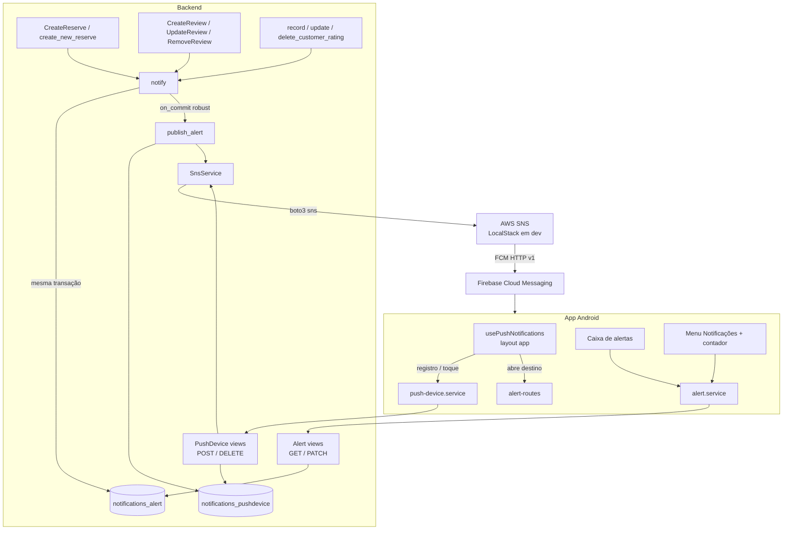

# Notificações push Design

**Spec**: `.specs/features/push-notifications/spec.md`
**Context**: `.specs/features/push-notifications/context.md`
**Status**: Draft

---

## Architecture Overview

O backend ganha um app Django novo, `notifications`, com dois modelos (`PushDevice` e `Alert`), um wrapper do SNS e uma função `notify()`. As views que geram eventos chamam `notify()` dentro da própria transação:
- `notify()` grava o `Alert` na mesma transação, então ele só existe se a ação fizer commit (NOTIF-19, NOTIF-20).
- A publicação no SNS é agendada com `transaction.on_commit(..., robust=True)`. Ela roda depois do commit e nunca propaga exceção para a view (NOTIF-23).

No app, um módulo de push com versão nativa e versão web é montado no layout `(app)`. Ele registra o aparelho a cada sessão e trata o toque no push. A caixa de alertas é uma tela por papel, as duas sobre o mesmo componente.



### Conformidade com as decisões do `STATE.md`

| AD | Como o design cumpre |
| --- | --- |
| AD-004 | As views usam `authenticated_user`, e nenhuma decodifica JWT. |
| AD-005 | Em dev, o SNS roda no LocalStack, e o backend busca o ARN da platform application pelo nome, como faz com o pool do Cognito. |
| AD-006 | Os erros saem por `problem_response`. Um slug novo, `push-unavailable` (503), entra nos três catálogos: `CATALOG`, a tabela do spec `api-problem-details` e `utils/api-problem.ts`. |
| AD-007 | As rotas RT-100 a RT-104 entram na Route Table e no `ROUTE_TABLE` antes do código. Paths no plural, `me` para o usuário da sessão, `PATCH` para atualização parcial, nenhum verbo no path. |
| AD-010, AD-012 | A nota do cliente notifica dentro de `record_customer_rating`, `update_customer_rating` e `delete_customer_rating`, o ponto único de escrita. |
| AD-011, AD-013 | Os endpoints do SNS saem na exclusão da conta e do aparelho depois do commit, sem garantia: a falha só vai para o log, como os arquivos do S3. |

Nenhuma lição está confirmada (`lessons.py list --status confirmed` vazio). A L-019, que trata da ordem entre validar o corpo e buscar o recurso, é seguida nas rotas novas.

---

## Code Reuse Analysis

### Existing Components to Leverage

| Component | Location | How to Use |
| --- | --- | --- |
| `CognitoService`, `get_cognito`, `reset_cognito` | `backend/users/cognito.py:85`, `:286` | Mesmo formato para o `SnsService`: client boto3 preguiçoso, `Config` com timeout, busca por nome quando a env var está vazia, singleton com reset. |
| `FakeCognitoIdp` e `fail_next` | `backend/users/cognito_fake.py` | Mesmo formato para o `FakeSns`: em memória, registra as chamadas e falha na próxima operação quando o teste pede. |
| `CognitoResetMixin` | `backend/hairmatch/test_runner.py:10` | Também passa a chamar `reset_sns()` antes de cada teste. |
| `authenticated_user` | `backend/users/authentication.py:56` | Auth das rotas de aparelho e de alerta. |
| `problem_response`, `validation_problem`, `body_error`, `json_object` | `backend/hairmatch/problems.py` | Erros e validação do corpo. |
| `LOCAL_TIMEZONE` | `backend/hairmatch/local_time.py:7` | Data e hora do texto em `America/Manaus`. |
| `transaction.on_commit` com `delete_stored_files` | `backend/review/views.py:194`, `backend/users/views.py:228` | Mesmo padrão "depois do commit, sem garantia" para publicar e para apagar endpoints. |
| `captureOnCommitCallbacks(execute=True)` | `backend/review/tests.py:800` | Testes que precisam ver a publicação. |
| `_delete_account_rows` | `backend/users/views.py:234` | Ponto onde se coletam os ARNs antes do `user.delete()`. |
| `ROUTE_TABLE` | `backend/hairmatch/test_routes.py:14` | RT-100 a RT-104. |
| Split nativo/web por sufixo de arquivo | `frontend-mobile/hooks/authHooks/useGoogleIdToken.ts` e `.web.ts` | `utils/push-registration.ts` e `utils/push-registration.web.ts`. |
| `MenuItem` | `frontend-mobile/components/modals/MenuItem/MenuItem.tsx` | Ganha uma prop opcional `badge`. |
| `problemMessage`, `ErrorModal` | `frontend-mobile/utils/api-problem.ts`, componentes de modal | Erros das telas novas. |
| `useFavoriteHairdressers` e `favorites.tsx` | `frontend-mobile/hooks/customerHooks/`, `app/(app)/customer/favorites.tsx` | Padrão de lista com `useFocusEffect`, atualização otimista com reversão e mensagem de lista vazia. |

### Integration Points

| System | Integration Method |
| --- | --- |
| `CreateReserve` (`reserve/views.py:136`) | `notify(reservation_created(reserve))` dentro do `transaction.atomic()` existente, depois do `Agenda.objects.create`. |
| `create_new_reserve` (`reserve/views.py:396`) | Igual. O `except Exception` amplo da função não vê falha de publicação, porque o `robust=True` e o `try` do publicador a contêm. |
| `CreateReview` (`review/views.py:120`) | Dentro do `atomic()`, depois de `reserve.save()`. |
| `UpdateReview` (`review/views.py:170`) | `review.save()` e `notify` passam a ficar num `transaction.atomic()`. |
| `RemoveReview` (`review/views.py:185`) | Dentro do `atomic()`, com o texto montado **antes** de `review.delete()` (NOTIF-25). |
| `customer_ratings.py` | Dentro do `atomic()` de cada função; em `delete_customer_rating`, o texto é montado antes do `delete()`. |
| `_delete_account_rows` (`users/views.py:234`) | Coleta os `endpoint_arn` do usuário antes do `user.delete()` e devolve junto com as fotos. `_delete_account` agenda `delete_endpoints(arns)` no `on_commit`. Aparelhos e alertas saem pelo `CASCADE`. |
| `signOut` (`frontend-mobile/app/_layout.tsx:127`) | `await unregisterPushDevice()` antes do `POST /api/auth/logout`, dentro do `try`. |
| `(app)/_layout.tsx` | Monta `usePushNotifications()`, que só roda com sessão. |
| `docker-compose.yml` e init do LocalStack | `SERVICES: s3,ses,sns`. O init cria a platform application `hairmatch-dev-fcm`. |

---

## Components

### Backend: modelos (`backend/notifications/models.py`)

- **Purpose**: guardar os aparelhos registrados e os alertas de cada usuário.
- **Location**: `backend/notifications/models.py`, migração `0001_initial`.
- **Interfaces**: os modelos abaixo (Data Models).
- **Dependencies**: `users.User`.
- **Reuses**: o padrão de app pequeno do `favorite`.

### Backend: `SnsService` (`backend/notifications/sns.py`)

- **Purpose**: único ponto de contato com o SNS. Converte erros do boto3 em erros de domínio e loga só a operação e o código do erro, nunca o token nem o ARN (NOTIF-77).
- **Location**: `backend/notifications/sns.py`. O fake fica em `backend/notifications/sns_fake.py`.
- **Interfaces**:
  - `create_endpoint(token: str) -> str`: chama `CreatePlatformEndpoint` sem `CustomUserData` e, em seguida, `SetEndpointAttributes(Enabled='true', Token=token)`. Isso reativa um endpoint que o SNS tinha desativado para o mesmo token. Devolve o ARN.
  - `delete_endpoint(arn: str) -> None`: `DeleteEndpoint`. Não existir conta como sucesso.
  - `publish(arn: str, title: str, body: str, data: dict[str, str]) -> None`: `Publish` com `MessageStructure='json'` e a mensagem FCM v1 (Tech Decisions). Levanta `EndpointGone` para `EndpointDisabled` e `NotFound`, e `PushUnavailable` para qualquer outro erro ou timeout.
  - `platform_application_arn` (property): `settings.SNS_PLATFORM_APPLICATION_ARN` ou, se vazia, a platform application cujo ARN termina em `/GCM/hairmatch-dev-fcm`, buscada por `ListPlatformApplications` com paginação. O valor fica em cache no objeto.
  - `get_sns()` e `reset_sns()`: singleton, que usa o `FakeSns` quando `settings.SNS_USE_FAKE`.
- **Dependencies**: `boto3`, com `Config(connect_timeout=2, read_timeout=3, retries={'max_attempts': 2, 'mode': 'standard'})`. O envio roda no thread da requisição, e esse limite segura o pior caso em poucos segundos por aparelho.
- **Reuses**: `users/cognito.py`.

### Backend: mensagens (`backend/notifications/messages.py`)

- **Purpose**: montar o destinatário, o `kind`, o título, o corpo e os dados de cada linha do catálogo do spec. São funções puras, testáveis sem banco.
- **Interfaces** (todas devolvem um `Message(recipient: User, kind: str, title: str, body: str, data: dict)`):
  - `reservation_created(reserve)`: dados `{reservation_id}`.
  - `review_created(review)` e `review_updated(review)`: dados `{review_id}`.
  - `review_deleted(review)`: chamada antes do delete. Dados `{}`.
  - `customer_rating_created(rating)` e `customer_rating_updated(rating)`: dados `{customer_rating_id}`.
  - `customer_rating_deleted(rating)`: chamada antes do delete. Dados `{}`.
  - `format_rating(value) -> str` ("5", "4,5") e `stars(value) -> str` ("estrela" ou "estrelas").
  - `local_date_time(dt) -> (str, str)`: `dd/mm` e `HH:MM` em `LOCAL_TIMEZONE`.

### Backend: `notify` e publicador (`backend/notifications/dispatch.py`)

- **Purpose**: gravar o alerta e publicar o push depois do commit.
- **Interfaces**:
  - `notify(message: Message, actor: User | None = None) -> Alert | None`. Devolve `None` sem gravar nada quando `message.recipient == actor` (NOTIF-26). Senão, cria o `Alert` e agenda `transaction.on_commit(lambda: publish_alert(alert.id), robust=True)`.
  - `publish_alert(alert_id: int) -> None`:
    1. lê o alerta e os aparelhos do destinatário naquele momento (NOTIF-73);
    2. para cada aparelho, chama `get_sns().publish(...)` com `data={'alert_id': str(id), 'kind': kind}`;
    3. num `EndpointGone`, apaga a linha e chama `delete_endpoint` (NOTIF-24);
    4. em qualquer outra `Exception`, loga e segue para o próximo aparelho.

    A função inteira fica num `try/except Exception` que só loga, porque o `on_commit` de um bloco `atomic` externo propagaria a exceção para a view depois do commit.
  - `delete_endpoints(arns: list[str]) -> None`: apaga cada um sem garantia, para uso no `on_commit` da exclusão de aparelho e de conta (NOTIF-07, NOTIF-10, NOTIF-11).

### Backend: views e rotas (`backend/notifications/views.py`, `urls.py`)

| RT | Rota | View | Contrato |
| --- | --- | --- | --- |
| RT-100 | `POST /api/users/me/push-devices` | `PushDeviceCollection.post` | Corpo `{token}`. 201 `{data: {id}}` (novo ou vindo de outra conta), 200 `{data: {id}}` (já era da conta). 400 `#/token`. 503 `push-unavailable`. |
| RT-101 | `DELETE /api/users/me/push-devices/{id}` | `PushDeviceDetail.delete` | 204. 404 se não é da conta. O endpoint sai no `on_commit`. |
| RT-102 | `GET /api/users/me/alerts` | `AlertCollection.get` | 200 `{data: {alerts: [...50], unread_count}}`. |
| RT-103 | `PATCH /api/users/me/alerts` | `AlertCollection.patch` | Corpo `{read: true}`. Marca todos e responde 204. `read: false` ou não booleano dá 400 `#/read`. |
| RT-104 | `PATCH /api/users/me/alerts/{id}` | `AlertDetail.patch` | Corpo `{read: bool}`. 200 `{data: alerta}`. 404 se não é da conta. |

O `POST` de aparelho roda numa transação, com a linha do token travada:
1. `select_for_update` no `PushDevice` pelo token.
2. Se a linha existe e é do usuário, responde 200 sem chamar o SNS. O endpoint já existe, e o token é o mesmo.
3. Se a linha é de outra conta, troca o `user` e responde 201. O ARN continua o mesmo, porque o endpoint pertence ao token.
4. Se a linha não existe, chama `create_endpoint` **fora** de qualquer lock longo e cria a linha. O `IntegrityError` de um `POST` concorrente com o mesmo token vira a leitura da linha vencedora (NOTIF-04), como no `record_customer_rating`.

### Backend: configuração

- `backend/hairmatch/settings.py`:
  - `INSTALLED_APPS += ['notifications']`;
  - `SNS_PLATFORM_APPLICATION_ARN = os.getenv('SNS_PLATFORM_APPLICATION_ARN', '')`;
  - `SNS_USE_FAKE = 'test' in sys.argv`.
- `backend/hairmatch/urls.py`: `path('api/', include('notifications.urls'))`, antes do catch-all.
- `backend/hairmatch/test_runner.py`: `reset_sns()` no `startTest`.
- `docker/docker-compose.yml`:
  - no backend, `SNS_PLATFORM_APPLICATION_ARN=${SNS_PLATFORM_APPLICATION_ARN:-}`;
  - no LocalStack, `SERVICES: s3,ses,sns`.
- `docker/localstack/init/01-resources.sh`: cria `hairmatch-dev-fcm` com `--platform GCM --attributes PlatformCredential=<json falso> --region "${AWS_DEFAULT_REGION:-us-east-2}"`, se ela ainda não existe.
- `docker/.env.example`: documenta `SNS_PLATFORM_APPLICATION_ARN`.

### App: serviços

- `frontend-mobile/services/push-device.service.ts`: `registerPushDevice(token): Promise<number>` e `deletePushDevice(id): Promise<void>`.
- `frontend-mobile/services/alert.service.ts`:
  - `getAlerts(): Promise<{alerts: Alert[]; unreadCount: number}>`;
  - `markAlertRead(id, read)`;
  - `markAllAlertsRead()`.
- `frontend-mobile/models/Alert.types.ts`: tipo `Alert` e a união `AlertKind`.

### App: registro e toque (`utils/push-registration.ts` e `.web.ts`)

- **Purpose**: isolar o `expo-notifications`. O web importa a versão `.web.ts`, que não faz nada (NOTIF-18).
- **Interfaces**:
  - `registerForPush(): Promise<void>`:
    1. cria o canal `default`;
    2. confere a permissão e só pede se ela nunca foi respondida (NOTIF-12, NOTIF-15);
    3. chama `getDevicePushTokenAsync` e `registerPushDevice`;
    4. guarda o `id` numa variável do módulo.

    Qualquer erro é engolido (NOTIF-16).
  - `onPushTokenChange()`: assina o `addPushTokenListener` e registra o token novo (NOTIF-14).
  - `unregisterForPush(): Promise<void>`: `deletePushDevice(id)` e esquece o `id`. Engole o erro (NOTIF-17).
  - `onAlertTap(handler)`: junta o `addNotificationResponseReceivedListener` com o `getLastNotificationResponseAsync`, para o caso do app aberto a partir do push (NOTIF-74). Lê `alert_id` e `kind` de `request.content.data`, com fallback para `request.trigger.remoteMessage.data` (risco R4).
  - `onAlertReceived(handler)`: `addNotificationReceivedListener`, para atualizar o contador (NOTIF-57).
  - Na carga do módulo: `setNotificationHandler`, com `shouldShowBanner` e `shouldShowList` true.

### App: `usePushNotifications` (`hooks/usePushNotifications.ts`)

- **Purpose**: ligar o registro e o toque ao ciclo da sessão.
- **Location**: montado em `app/(app)/_layout.tsx`.
- **Behavior**:
  - No mount, chama `registerForPush()` e `onPushTokenChange()`.
  - No toque, chama `markAlertRead(id, true)` direto:
    1. com 200, faz `router.push(alertRoute(kind, role))`;
    2. com 404, o alerta é de outra conta (o aparelho trocou de dono depois do envio), e o hook abre a caixa (NOTIF-75).

    O `PATCH` responde 404 para alerta de outra conta, então serve de checagem de posse sem buscar a lista, que só traz os 50 mais recentes.
  - Sem sessão, o layout `(app)` redireciona para o login (NOTIF-76).

### App: `alertRoute` (`utils/alert-routes.ts`)

Função pura `alertRoute(kind, role): Href | null`:
- `reservation-created` → `/(app)/hairdresser/agenda`;
- `customer-rating-*` → `/(app)/customer/ratings`;
- `review-*` → `null`, ou seja, fica na caixa (#189 troca esse destino).

### App: caixa de alertas

- `hooks/useAlerts.ts`:
  - lista no `useFocusEffect`;
  - `open(alert)`, que marca como lido de forma otimista, chama o `PATCH` e navega por `alertRoute`;
  - `markAll()`;
  - reversão e `ErrorModal` na falha (NOTIF-50 a NOTIF-55).
- `components/alerts/AlertList.tsx`: lista com destaque para os não lidos, data relativa ("agora", "há N min", "há N h", "ontem", `dd/mm`), botão "Marcar todas como lidas" e a mensagem de lista vazia.
- Telas:
  - `app/(app)/customer/notifications.tsx`, registrada com `href: null` no `customer/_layout.tsx`;
  - `app/(app)/hairdresser/profile/notifications.tsx`, dentro do stack `profile/_layout.tsx`.
- `hooks/useUnreadAlertsCount.ts`: `GET` no foco e no `onAlertReceived`. Esconde o número quando falha (NOTIF-56 a NOTIF-58).
- `MenuItem`: prop `badge?: string`, que mostra "N" ou "99+".

### App: configuração nativa

- `npx expo install expo-notifications`.
- `app.json`: plugin `["expo-notifications", {"defaultChannel": "default", "color": "#ffffff"}]`.
- `app.config.js` (novo): recebe a config do `app.json` e define `android.googleServicesFile = process.env.GOOGLE_SERVICES_JSON ?? './google-services.json'`.
- `.gitignore` do `frontend-mobile`: `google-services.json`.
- O dev build precisa ser refeito. O módulo nativo novo não carrega no dev client atual.

---

## Data Models

### `PushDevice`

```python
class PushDevice(models.Model):
    user = models.ForeignKey(User, on_delete=models.CASCADE, related_name='push_devices')
    token = models.CharField(max_length=1024, unique=True)
    endpoint_arn = models.CharField(max_length=512)
    created_at = models.DateTimeField(auto_now_add=True)
    updated_at = models.DateTimeField(auto_now=True)
```

### `Alert`

```python
class Alert(models.Model):
    KINDS = ['reservation-created', 'review-created', 'review-updated', 'review-deleted',
             'customer-rating-created', 'customer-rating-updated', 'customer-rating-deleted']
    recipient = models.ForeignKey(User, on_delete=models.CASCADE, related_name='alerts')
    kind = models.CharField(max_length=40, choices=[(k, k) for k in KINDS])
    title = models.CharField(max_length=100)
    body = models.CharField(max_length=300)
    data = models.JSONField(default=dict)   # ids do recurso; nunca dado pessoal além do texto
    read_at = models.DateTimeField(null=True, blank=True)
    created_at = models.DateTimeField(auto_now_add=True)

    class Meta:
        ordering = ['-created_at', '-id']
        indexes = [models.Index(fields=['recipient', '-created_at'])]
```

- **Relationships**: as duas tabelas são `CASCADE` a partir do `User`, então a exclusão da conta as limpa (NOTIF-11, NOTIF-46).
- **Formato na API**: o alerta sai como `{id, kind, title, body, data, read: read_at is not None, created_at}`.
- **Estado de leitura**: `read_at` guarda quando o alerta foi lido. `PATCH read: false` limpa o campo.

---

## Error Handling Strategy

| Error Scenario | Handling | User Impact |
| --- | --- | --- |
| SNS fora do ar no registro | 503 `push-unavailable`, sem linha gravada, log com a operação e o código. | Nenhum: o app ignora, e o próximo login tenta de novo. |
| SNS fora do ar ou lento no envio | O publicador loga e segue. Os timeouts (2 s + 3 s, 2 tentativas) limitam o atraso. | A ação responde normalmente. O push daquele alerta se perde, e o alerta continua na caixa. |
| Endpoint desativado ou inexistente | A linha e o endpoint são apagados, e o envio segue nos outros aparelhos. | O aparelho volta a receber depois do próximo login. |
| Exceção inesperada no publicador | `try/except Exception` em volta de tudo, mais o `robust=True`. | Nenhum, e a view não responde 500. |
| Falha ao apagar endpoint | Só log. | Nenhum: a linha já saiu, e um endpoint órfão no SNS não recebe nada. |
| `getDevicePushTokenAsync` falha | O erro é engolido. | Sem push naquele aparelho. A caixa continua funcionando. |
| `GET` ou `PATCH` de alertas falha no app | Reversão otimista e `ErrorModal` com `problemMessage`. | Mensagem do slug ou o fallback do spec. |

---

## Risks & Concerns

| Concern | Location (file:line) | Impact | Mitigation |
| --- | --- | --- | --- |
| Exceção no `on_commit` chega à view depois do commit | `django/db/transaction.py:129` (`robust=False` por padrão) | O `CreateReserve` responderia 500 para uma reserva já gravada. O chatbot diria ao cliente que a reserva falhou, e os callbacks seguintes (`delete_stored_files`) não rodariam. | `robust=True` mais um `try/except Exception` no publicador. Teste com o fake falhando e `captureOnCommitCallbacks(execute=True)`. |
| O `TestCase` não roda `on_commit` | Testes de `review`, `reserve` e `notifications` | Um teste de "não publicou" passaria por engano. | Todo teste de envio usa `captureOnCommitCallbacks(execute=True)`, e o Verifier inclui mutantes que removem a publicação. |
| Envio síncrono no thread da requisição | `publish_alert` | Cada aparelho soma latência à resposta, inclusive no webhook do chatbot. | Timeouts curtos e poucas tentativas. A fila assíncrona fica para a #185. |
| O LocalStack pode não aceitar SNS na licença atual, ou recusar uma platform application GCM com credencial falsa | `docker/docker-compose.yml:110` | O ambiente local não teria SNS. | A T6 é um go/no-go: sobe o LocalStack, cria a platform application, registra um endpoint e consulta `/_aws/sns/platform-endpoint-messages?region=us-east-2`. Se falhar, parar e decidir com o usuário. Uma opção a avaliar é apontar só o SNS para outro emulador por `AWS_ENDPOINT_URL_SNS`, sem mudar o código. O suporte a SNS mobile no MiniStack não foi verificado. |
| Os dados do push chegam em lugares diferentes conforme o estado do app (R4) | `utils/push-registration.ts` | Um toque com o app fechado poderia não achar o `alert_id`. | Ler `content.data` com fallback para `trigger.remoteMessage.data`. O UAT testa o toque com o app fechado. Não foi verificado na documentação: a página do SDK 57 só mostra `content.data`. |
| Privacidade na tela de bloqueio | Logout com o `DELETE` falhando | O aparelho deslogado continua recebendo pushes com nomes da conta anterior. | O token passa para a próxima conta que logar no aparelho (NOTIF-03), e o endpoint é apagado no primeiro `EndpointGone`. Registrado como risco aceito. |
| `create_new_reserve` com `except Exception` amplo | `backend/reserve/views.py:414` | Esconderia um erro no `notify` dentro da transação. | O `notify` só faz um `INSERT` simples, e uma falha nele desfaz a reserva, como qualquer erro de banco. O teste NOTIF-29 cobre o caminho feliz. |
| A edição da review pelo app são três chamadas | `useReviewForm.ts:135` | Notificar as fotos geraria vários avisos para uma edição. | Só o `PUT` notifica (NOTIF-62). |
| `select_for_update` não trava uma linha que ainda não existe | `PushDeviceCollection.post` | Dois `POST` com o mesmo token nunca vistos podem criar dois endpoints. | O `UNIQUE(token)` garante uma linha só, e o perdedor relê a linha vencedora. Criar o mesmo endpoint duas vezes no SNS é idempotente para o mesmo token. Teste com `TransactionTestCase`, como o `CustomerRatingRaceTest`. |

---

## Tech Decisions

| Decision | Choice | Rationale |
| --- | --- | --- |
| Quando publicar | Na mesma requisição, depois do commit (`on_commit(robust=True)`). | Não há fila nem worker. Alternativas consideradas: (a) uma fila SQS mais um worker, que é a recomendada quando houver scheduler (#185) e tiraria a latência da requisição, mas exige processo novo; (b) uma thread em segundo plano, que perderia mensagens num restart sem dar visibilidade. A escolha é a mais simples que cumpre NOTIF-23. |
| Formato da mensagem | `MessageStructure='json'`, `{"default": body, "GCM": json.dumps({"fcmV1Message": {"message": {"notification": {"title", "body"}, "data": {"alert_id", "kind"}, "android": {"priority": "high", "notification": {"channel_id": "default"}}}}})}`. | Formato FCM v1 da documentação do SNS. Todo valor em `data` é string, ou o FCM responde `INVALID_ARGUMENT`. O `channel_id` é o mesmo do canal do app e do `defaultChannel` do plugin. |
| Credencial do FCM | Token-based (JSON da service account) no `PlatformCredential` da platform application, configurado na AWS. | O FCM legado acabou. O backend nunca vê a credencial. |
| Endpoint por aparelho e não tópico | `CreatePlatformEndpoint` por token, `Publish` por `TargetArn`. | Cada alerta tem um destinatário só, e o tópico só serviria para fan-out (#186). |
| Busca da platform application em dev | Pelo nome, quando `SNS_PLATFORM_APPLICATION_ARN` está vazia. | Mesmo padrão do Cognito (AD-005). O LocalStack recria a platform application a cada boot, porque os recursos são efêmeros. |
| Token inválido | Apagar a linha no `EndpointDisabled` ou no `NotFound` do `Publish`. | O SNS desativa o endpoint quando o FCM responde `UNREGISTERED`. Reativar sem token novo não adianta. |
| `id` do aparelho no app | Em memória, sem dependência nova. | O registro se repete a cada sessão, e o `POST` é idempotente. |
| `google-services.json` | Fora do git. Variável de arquivo no EAS, mais o `app.config.js`. | Ver a tabela de assumptions do spec. |

> **Decisão de projeto (vai para o `STATE.md` como AD-014):** toda notificação a um usuário passa por `notifications.dispatch.notify()`. Ela grava um `Alert` na transação da ação e publica no SNS depois do commit, sem propagar falha. Nenhuma view chama o SNS direto.
